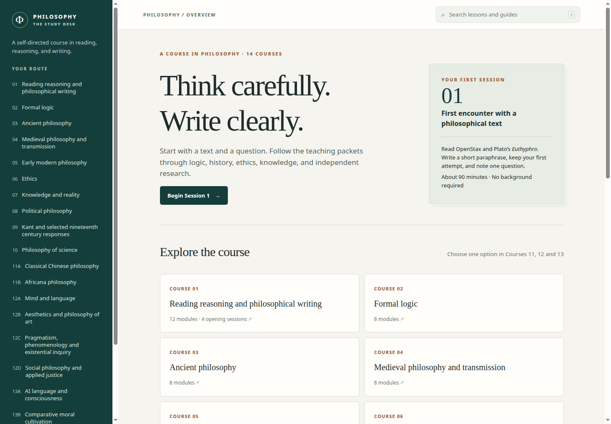
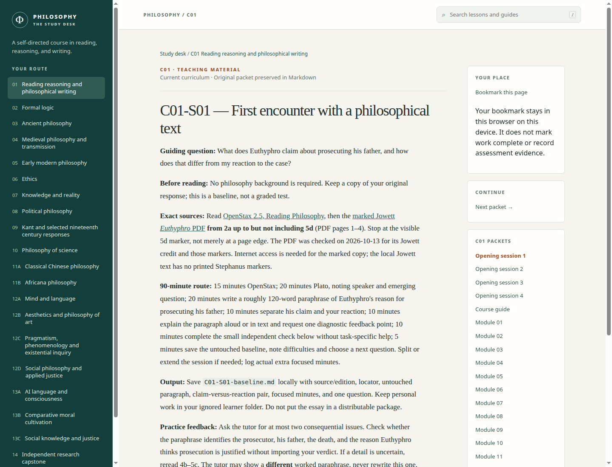

# Philosophy course

**Start in the [Study desk](course/index.html).** Open `course/index.html` in a browser to browse the current fourteen-course curriculum, read teaching packets, search the materials, and bookmark your place locally. It works offline after checkout, with no account or server. External readings still need their stated access route. The authored curriculum, not the browser's bookmark, governs learning evidence and completion.

The Study desk presents all **20 tracks and 147 distinct baseline modules**, plus four opening sessions and reference material. Choose one option in each of Courses 11, 12, and 13. Course 13 options share the same eight-module sequence. The [teaching index](instruction/README.md) and [current curriculum](current/README.md) remain the editable sources; the [older fifteen-unit collection](collection/README.md) is preserved for historical use.

To launch from a checkout, double-click `course/index.html`, or run `xdg-open course/index.html` on Linux. To rebuild the browser content after editing Markdown, run `python3 scripts/build_course_ui.py` (requires Pandoc), then `python3 scripts/check_course.py` and commit the updated `course/content.js`. The browser itself has no runtime dependency. A bookmark stores only the page path in your browser's local storage; clear it in the reading sidebar. Personal work belongs in the ignored `learner/` directory.

The first session assigns [OpenStax 2.5](https://openstax.org/books/introduction-philosophy/pages/2-5-reading-philosophy) and Plato's *Euthyphro* [2a up to before 5d](https://persweb.wabash.edu/facstaff/helmang/phi110-1516F/phi110-handouts/Euthyphro.pdf), then a 120-word paraphrase. Keep your untouched attempt and one question. [Source access/status](instruction/source-status.md) matters before reading-dependent work. AI content review does not establish a real learner pilot, human expert validation, exact-edition access, rights clearance, or rendered accessibility testing. The program awards no credit or external certification.

## Which rules apply

The Markdown pages in [current/](current/README.md) are the editable curriculum authority. The September 30 [revised DOCX](Philosophy%20curriculum%20and%20writing%20foundations.docx) and [conversion snapshot](archive/revised-curriculum-pandoc-baseline.md) are preserved baselines. The original fifteen-unit source in [collection/](collection/README.md) is historical and its numerical gates, tutor rules, and public-template instructions are superseded. Use the [active tutor rules](instruction/tutor.md) and [private learner record](instruction/learner-record.md).

The current default route is writing-first, then logic and the core courses, one global-tradition option, one selected area, an advanced seminar, and a capstone. The preserved source baseline is 1,890 focused hours for the default route and 1,270 through Course 10. The [authored workload](instruction/workload.md) totals **1,970 planned hours** for the default route and **1,336 through Course 10**, with shared language work, conditional credits and six optional probability hours stated separately. These are planning allocations, not measured learner effort. The program awards no credit or external certification.

The [stopping and continuation milestones](current/milestones.md) describe what each checkpoint actually demonstrates. [Direct route options](current/route-options.md) list prerequisite-compatible combinations and their source-baseline hours. [Optional listening](instruction/audio-handoff.md) has a short text-check handoff; every essential task has a written route.

## Files and rights

- [Source packages](source-packages/) preserve the 14 numbered ZIPs, earlier standalone packs, and separate retrieval-tool source. Bundled workflows are archived, not installed as this repository's CI.
- [Collection](collection/philosophy-study-collection/) holds the extracted private-study reading library. Many third-party readings and audio have no general redistribution permission; the [manifest](philosophy-materials-manifest.txt) and [access gaps](philosophy-access-gaps.txt) describe individual sources and missing material. Keep this repository private. No whole-collection license is asserted.
- [Data](data/course.json) records current reading IDs, editions, assets and bounded opening assignments. [Authored workload](data/authored-workload.json) derives current allocations from course manifests; [historical workload](data/workload.json) preserves earlier proposal estimates. A filtered local teaching package uses an explicit allowlist and excludes reading collections and private learner work. This is not permission to distribute third-party content.
- [Unified plan](implementation/UNIFIED_PLAN.md), [implementation status](implementation/STATUS.md), [PC-by-PC register](implementation/TASK_REGISTER.md), [decisions](implementation/DECISIONS.md), and [maintenance procedure](implementation/MAINTENANCE.md) explain scope and limits. Run `python3 scripts/check_course.py` in a clean checkout to check all teaching tracks, exact reviewed inventories, current links, identifiers, budgets, preserved sources and generated views.

Personal work goes in the ignored `learner/` directory. The repository's old source and original packages remain recoverable in Git history; do not publish or share the private reading collection as an anthology.
