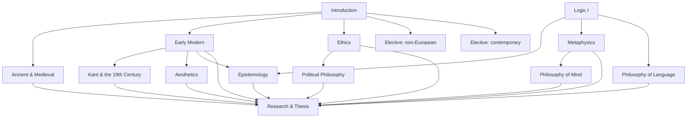

# Unit map

The program has 15 units in four stages, each unit sized to a real university course. There are no semesters or deadlines: only prerequisites and gates.

## How progression works

- **Read ahead freely.** You can start or read any unit at any time.
- **Mastery follows prerequisites.** A unit counts as **mastered** when you've passed its gate, passed its confirmation check about four weeks later, and mastered all of its prerequisites. Until then it's recorded as **gate passed**.
- **Test out.** If you already know a unit's material, take its gate directly.
- **Review never stops.** Material from every unit you've worked on keeps coming back in the review queue (see the [Director of Studies](../roles/director-of-studies.md#review-queue)).

## Stages

| Stage | Units | Help from the Tutor |
|---|---|---|
| Foundations | 2 | The most: hints up to Level 3, and model reconstructions after attempts |
| Core | 10 | Less: hints up to Level 2, and models only after revision |
| Advanced | 2 | Little: questions and Level 1 hints |
| Capstone | 1 | Little: questions and Level 1 hints |

## Units

| Stage | Unit | Requires | Status |
|---|---|---|---|
| Foundations | [Introduction to Philosophy](units/introduction.md) | none | complete |
| Foundations | [Logic I](units/logic-1.md) | none | outline |
| Core | [Ancient & Medieval Philosophy](units/ancient-medieval.md) | Introduction | outline |
| Core | [Early Modern Philosophy](units/early-modern.md) | Introduction | outline |
| Core | [Kant & the 19th Century](units/kant-19th-century.md) | Early Modern | outline |
| Core | [Ethics](units/ethics.md) | Introduction | outline |
| Core | [Political Philosophy](units/political-philosophy.md) | Ethics | outline |
| Core | [Epistemology](units/epistemology.md) | Logic I, Early Modern | outline |
| Core | [Metaphysics](units/metaphysics.md) | Logic I | outline |
| Core | [Philosophy of Language](units/philosophy-of-language.md) | Logic I | outline |
| Core | [Philosophy of Mind](units/philosophy-of-mind.md) | Metaphysics | outline |
| Core | [Aesthetics](units/aesthetics.md) | Early Modern | outline |
| Advanced | [Elective: a non-European tradition](units/elective-non-european.md) | Introduction (options may add more) | outline |
| Advanced | [Elective: a contemporary area](units/elective-contemporary.md) | Introduction (options may add more) | outline |
| Capstone | [Research & Thesis](units/research-thesis.md) | all ten Core units | outline |

**Outline** means a unit has its prerequisites, anchor readings, mastery criteria, and gate, but not yet a step-by-step plan or a benchmarked full reading list. **Complete** means it has everything.

## Dependency graph

## The unit cycle

Every unit follows roughly the same sequence, with no dates attached:

1. **Start:** a short diagnostic or placement conversation (Director, Tutor).
2. **Read:** primary texts, using the four-pass protocol (Tutor).
3. **Practise:** reconstructions, argument maps, labs, and problem sets (Assignment Designer, Tutor).
4. **Discuss:** Socratic tutorials and close reading (Tutor); debates and seminars by voice (Debate Partner).
5. **Write:** précis, then essays with feedback and revision (Tutor), scored as practice by the Examiner.
6. **Research** (Core and above): the SEP and scholarly literature, with every source checked (Verifier).
7. **Gate:** written exam, oral exam, revised paper, and dashboard check (Examiner).
8. **Reflect:** what changed in your thinking, and which arguments changed it (Director).
9. **Confirm:** the confirmation check about four weeks later (Examiner).

Throughout, the review queue brings back earlier material.
