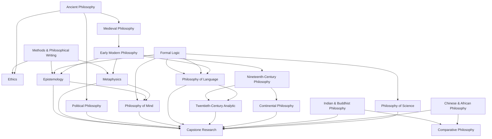

# A University-Level Self-Study Curriculum in Philosophy, Designed Around an OpenAI “Dot” Tutor

## Executive summary

A serious self-education in philosophy should not be designed as “read famous books and ask an AI questions.” It should be designed as a **degree-like sequence of courses, repeated practice in philosophical writing and argument, cumulative examinations, oral defense, and a final independent research project**. That structure is much closer to what strong university departments actually require. Stanford's philosophy major combines introductory work, logic, philosophy of science, value theory, contemporary theoretical philosophy, Greek philosophy, modern philosophy, writing, electives, and a capstone; Rutgers requires logic, ancient/medieval philosophy, modern philosophy, ethics or political philosophy, and advanced theoretical philosophy; Princeton organizes its major across metaphysics, ethics/value, logic/science, and history and adds substantial independent work. citeturn5search6turn5search17turn5search12turn15search9

The curriculum below therefore uses **eighteen three-credit-equivalent modules**, totaling **54 credit-equivalent hours**. Under the U.S. federal credit-hour convention, one credit corresponds roughly to one hour of instruction plus at least two hours of outside work each week over approximately fifteen weeks. A three-credit course is therefore about **135 total learning hours**, making this curriculum approximately **2,430 hours of serious study**. These are workload equivalents, not transferable academic credits or an accredited degree. citeturn10search9

The proposed sequence is:

| Stage | Modules |
|---|---|
| Semester A | Philosophical Methods & Writing; Formal Logic; Ancient Philosophy |
| Semester B | Medieval Philosophy; Ethics; Early Modern Philosophy |
| Semester C | Epistemology; Metaphysics; Political Philosophy |
| Semester D | Philosophy of Mind; Philosophy of Language; Nineteenth-Century Philosophy |
| Semester E | Twentieth-Century Analytic Philosophy; Continental Philosophy; Indian & Buddhist Philosophy |
| Semester F | Chinese, African & Comparative Philosophy; Philosophy of Science; Capstone Research Seminar |

The central recommendation is to use your philosophy dot **not as an answer engine, but as a combination of Socratic tutor, seminar interlocutor, examiner, writing coach, and study manager**. OpenAI's September 29, 2026 announcement describes dots as persistent agents capable of carrying context, learning from feedback, conversing naturally, and working through connected tools; OpenAI also explicitly cautions that dots can make mistakes. That combination makes persistence particularly valuable for long-term education, while making source verification indispensable. citeturn3view0

OpenAI's earlier Study Mode provides a useful pedagogical model: it was explicitly designed around guiding questions, step-by-step scaffolding, adapting to the learner's level, checking understanding, encouraging active participation, and supporting metacognition rather than simply dispensing answers. citeturn6search1turn6search10 A randomized controlled trial involving 194 Harvard undergraduates in physics likewise found substantially greater learning gains from a **carefully structured** AI tutor than from the comparison active-learning class; crucially, the tutor was designed around scaffolding, active engagement, targeted feedback, cognitive-load management, and structured content rather than unrestricted chatbot use. The authors specifically warned that unguided generative AI can let students bypass critical thinking. Because that experiment was in physics, it should be treated as evidence for tutoring architecture, not proof that an AI tutor will outperform a human philosophy professor. citeturn7search9

For philosophy, that architecture should produce a simple rule:

> **The dot should make you do philosophy before it explains philosophy.**

Reading is necessary but insufficient. Every week should include retrieval from memory, reconstruction of arguments, objections and replies, close textual analysis, formal exercises where relevant, Socratic dialogue, and independent writing. Retrieval practice has strong experimental support for long-term learning; distributed practice has strong meta-analytic support; and self-explanation is associated with substantially deeper learning than passive review. citeturn9search8turn9search1turn9search2

A successful graduate of this self-designed program should be able to:

| Competency | Target at completion |
|---|---|
| Argument analysis | Identify conclusions, explicit and hidden premises, validity, soundness, counterexamples, and dialectical structure |
| Formal reasoning | Work comfortably with propositional and first-order logic and understand the philosophical role of formalization |
| Historical knowledge | Explain major developments from antiquity through contemporary philosophy without treating philosophy as exclusively European |
| Core fields | Work at upper-undergraduate level in epistemology, metaphysics, ethics, political philosophy, mind, language, and philosophy of science |
| Textual interpretation | Closely interpret difficult primary texts while distinguishing textual evidence from interpretive reconstruction |
| Philosophical writing | Produce clear 2,500–4,000-word argumentative papers and revise them in response to criticism |
| Oral philosophy | Defend positions and respond to objections without notes in a fifteen-to-thirty-minute viva |
| Independent research | Formulate a tractable question, build a scholarly bibliography, write a 6,000–8,000-word capstone, and defend it orally |
| Intellectual independence | Recognize when the AI, a textbook, a famous philosopher, or one's own first interpretation is wrong |

The goal is therefore **major-level philosophical competence**, not merely familiarity with famous ideas. A genuine university degree additionally supplies institutional accreditation, professors who judge your work, peers who disagree with you, general-education coursework, scholarly communities, and opportunities that self-study cannot completely reproduce.

## Pedagogy for an AI philosophy professor

### What the dot should actually do

The greatest risk of AI tutoring in philosophy is paradoxical: the system can make difficult thinking feel easy by doing the difficult thinking for you. That is precisely what must be prevented. OpenAI's own education design emphasizes guided inquiry and comprehension checks rather than immediate solutions, while the strongest experimental AI-tutoring evidence so far also depends on deliberately structured scaffolding rather than free-form answer generation. citeturn6search1turn6search10turn7search9

Your dot should alternate among six roles.

| Role | What the dot does | What it must not do |
|---|---|---|
| **Socratic tutor** | Asks sequenced questions and supplies progressively stronger hints | Immediately give the interpretation or answer |
| **Text seminar leader** | Makes you paraphrase passages, identify claims, and defend textual interpretations | Invent quotations, page numbers, or unsupported authorial intentions |
| **Dialectical opponent** | Generates serious objections and forces you to answer them | Accept vague responses because they “sound philosophical” |
| **Logic instructor** | Generates symbolization, truth-table, derivation, validity, and countermodel exercises | Reveal solutions before a genuine attempt |
| **Writing instructor** | Diagnoses thesis, structure, exposition, argument, objections, and prose separately | Ghostwrite the essay before you have composed it |
| **Examiner** | Runs closed-note oral and written examinations and records weaknesses | Hint during an exam unless you explicitly end exam conditions |

The American Philosophical Association's undergraduate guide emphasizes philosophy's role in interpretation, comparison, argument, and fair consideration of alternative positions. Jim Pryor's widely used philosophy-writing guide likewise treats a philosophy paper as a **reasoned defense of a claim**, emphasizing explicit structure, clear arguments, accurate presentation of opposing views, and straightforward prose. Those are better objectives for your dot than encyclopedic information recall. citeturn23search8turn15search16

### The learning cycle

For every important philosophical idea, use a repeated six-stage cycle:

**Encounter → Reconstruct → Challenge → Defend → Retrieve → Transfer**

You first encounter the idea in a primary text. Before consulting commentary, explain what you think the author is arguing. Then formally or informally reconstruct the reasoning. Your dot attacks the reconstruction with the strongest plausible objection. You revise or defend it. Days later, the dot asks you to reconstruct it again without notes. Finally, you apply it to another philosopher or problem.

For example, after reading Descartes:

> **Encounter:** Read Meditation I without secondary commentary.  
> **Reconstruct:** State the dream argument as numbered premises and conclusion.  
> **Challenge:** Let the dot identify the weakest premise.  
> **Defend:** Argue on Descartes's behalf.  
> **Retrieve:** Reconstruct the argument three days later without the text.  
> **Transfer:** Compare its skeptical structure with a contemporary skeptical scenario or a Buddhist challenge to ordinary cognition.

That is much more educationally powerful than asking, “Explain Descartes's skepticism.”

Retrieval and spaced repetition are especially useful for distinctions, arguments, logical forms, historical relationships, terminology, and philosopher-position pairings; self-explanation is especially useful for passages and complex arguments. citeturn9search8turn9search1turn9search2

### Philosophy-specific active learning

A good dot should repeatedly require the following kinds of intellectual action.

**Argument reconstruction.** Take prose and convert it into a conclusion supported by numbered premises. Then ask whether the inference is deductive, inductive, abductive, transcendental, conceptual, genealogical, phenomenological, or some mixture. This prevents “I understand the vibe of the philosopher” from masquerading as understanding.

**Charitable reconstruction.** Require yourself to formulate an opponent's position strongly enough that a sophisticated defender could recognize it. Pryor similarly emphasizes accurate presentation of opposing arguments before criticism. citeturn15search16

**Counterexample construction.** For definitions and universal principles, search deliberately for cases that satisfy one condition without satisfying another. This is indispensable in epistemology, metaphysics, ethics, philosophy of mind, and language.

**Dialectical role switching.** Defend utilitarianism for fifteen minutes; then attack it. Defend physicalism; then dualism. Defend Rawls; then Nozick. Your personal opinion should not determine which position you can explain well.

**Close reading.** The tutor selects five to fifteen difficult lines. You paraphrase each sentence, identify transitions, define technical terms from context, locate an argument, and explain how the passage relates to the larger work.

**Comparative reconstruction.** Explain the difference between Plato's Forms and Aristotle's substances, Descartes's and Hume's conceptions of self, Kantian autonomy and Millian welfare, Fregean sense and Russellian description, or Nāgārjuna's emptiness and a Western anti-essentialist position without collapsing one into the other.

**Oral vivas.** Philosophy is unusually suitable for conversational examination. The dot should interrupt, request definitions, introduce counterexamples, and change the hypothetical until it becomes clear whether you understand the position or have memorized a paragraph.

**Independent writing before AI feedback.** Your first substantive outline and first complete draft should be yours. AI critique comes afterward. Otherwise you lose the very activity the assignment is supposed to train.

### Accuracy and epistemic discipline

OpenAI itself warns that dots can make mistakes. citeturn3view0 For philosophy, three errors are particularly dangerous: fabricated quotations, false page references, and presentation of a disputed interpretation as settled fact.

Adopt an evidence hierarchy:

**Primary text → scholarly edition or journal article → Stanford Encyclopedia of Philosophy / specialist reference work → scholarly textbook → university lecture → AI explanation.**

The Stanford Encyclopedia of Philosophy is particularly valuable for advanced orientation and bibliographies; its entries are written and maintained as scholarly reference articles, and entries on subjects such as metaphysics, Frege, and Du Bois can serve as starting points for specialist secondary reading. citeturn19search15turn17search0turn17search20

Give your dot a permanent rule:

> Never attribute a quotation or precise page number unless it is visible in a source I supplied or in a source you can actually verify. Distinguish **textual evidence**, **common scholarly interpretation**, **your reconstruction**, and **controversial interpretation**.

The dot should also say “I do not know” when necessary. That is pedagogically preferable to a confident invented answer.

### A permanent operating prompt for your philosophy dot

The following can serve as the standing instructional constitution for the tutor:

```text
You are my university-level philosophy professor and tutor.

Your purpose is to develop my independent philosophical ability, not to make
philosophy easy for me and not to substitute your thinking for mine.

GENERAL METHOD
1. Elicit my attempt before explaining a problem.
2. Use Socratic questions and one hint at a time.
3. Ask me to define important terms in my own words.
4. Make me reconstruct arguments as premises and conclusions whenever possible.
5. Distinguish validity, soundness, plausibility, textual interpretation,
   and rhetorical force.
6. Regularly ask for counterexamples, objections, replies, and alternative
   interpretations.
7. Make me defend positions I disagree with.
8. Periodically make me teach the material back to you without notes.
9. Maintain a mastery ledger of concepts, arguments, philosophers,
   readings, logic skills, essays, and examination results.
10. Schedule delayed retrieval of weak material.

SOURCE DISCIPLINE
11. Treat the primary philosophical text as the first authority on what an
    author says.
12. Never invent quotations, citations, page numbers, or passages.
13. Label disputed interpretations as disputed.
14. Separate:
    a. what the text explicitly states,
    b. what scholars commonly infer,
    c. your own explanatory reconstruction.
15. Tell me when you are uncertain.

WRITING
16. Do not write my first draft for me.
17. Require my thesis and argument outline first.
18. Give feedback in separate passes:
    thesis/question → exposition → argument → objections/replies →
    organization → style/citations.
19. Prefer questions and diagnoses over replacement prose.
20. After revision, grade the work against the agreed rubric and justify
    every deduction.

EXAM MODE
21. When I say EXAM MODE, do not hint, correct, or teach until the exam ends.
22. Use cumulative questions, not merely the most recent material.
23. Include oral follow-ups that distinguish memorization from understanding.

DIFFICULTY
24. Gradually increase difficulty as mastery improves.
25. Do not praise an answer simply for being fluent. Identify exactly what
    is correct, incomplete, ambiguous, or mistaken.
```

This approach translates the Socratic, stepwise and comprehension-checking behavior described in OpenAI's Study Mode into a persistent long-term tutor. citeturn6search1turn6search10

## Curriculum architecture and sequencing

### The major-equivalent structure

The curriculum is deliberately broader than the minimum requirements at many universities. Rutgers, for example, specifies eleven classroom philosophy courses with distribution requirements; Stanford's program requires sixty quarter units distributed across methods, logic, history, value theory, theoretical philosophy, science, and capstone work; Princeton requires eight departmental courses distributed across major areas plus independent work. citeturn5search6turn5search17turn5search12turn15search9

Your 54-credit-equivalent plan uses eighteen modules × approximately 135 hours = **2,430 hours**. citeturn10search9

A normal module should roughly allocate its 135 hours like this:

| Activity | Approximate hours |
|---|---:|
| Primary-text reading and annotation | 35 |
| Textbook, secondary literature and lectures | 20 |
| Tutorials/seminars with the dot | 20 |
| Essays, argument reconstructions or formal problem sets | 35 |
| Retrieval, cumulative review, oral exams and final exam | 25 |
| **Total** | **135** |

This is not meant to be mechanically exact. Hegel may consume far more reading time than introductory ethics; formal logic may replace much of its reading time with exercises. The point is to prevent “I finished the book” from becoming the definition of completing a course.

### Curriculum map



### Semester-by-semester plan

| Semester | Courses | Central purpose | Principal assessments |
|---|---|---|---|
| **A** | Philosophical Methods & Writing; Formal Logic; Ancient Philosophy | Learn what arguments are, how philosophical prose works, and where many enduring problems begin | Short argument papers; logic problem sets/exams; close-reading commentary |
| **B** | Medieval Philosophy; Ethics; Early Modern Philosophy | Develop historical continuity and encounter major theories of value, mind, knowledge and God | Comparative history essay; normative argument paper; primary-text exam |
| **C** | Epistemology; Metaphysics; Political Philosophy | Build the central theoretical core of an analytic undergraduate education | Counterexample exercises; two analytic papers; oral political-theory viva |
| **D** | Mind; Language; Nineteenth-Century Philosophy | Apply logic, epistemology and metaphysics to consciousness/meaning while entering post-Kantian thought | Mind paper; semantic exercises; historical comparative paper |
| **E** | Twentieth-Century Analytic; Continental; Indian & Buddhist Philosophy | Encounter divergent twentieth-century methods and major South Asian traditions | Argument reconstructions; phenomenological close reading; comparative exegesis |
| **F** | Chinese, African & Comparative Philosophy; Philosophy of Science; Capstone | Broaden the canon, integrate methods, and demonstrate independent research competence | Comparative essay; science paper/exam; 6,000–8,000-word thesis + viva |

The chronology is intentional but not intended to suggest that non-European philosophy is somehow “advanced material that comes later.” Dedicated global courses appear later because comparative work becomes richer after methodological training. From the first semester onward, incorporate bridge readings from Confucian, Buddhist, Islamic, Jewish, African, and other traditions. Peter Adamson's *History of Philosophy without any gaps* is unusually useful for this purpose because its program explicitly includes Greek, late antique, Islamic, medieval, Indian, and Chinese philosophical traditions rather than treating the history of philosophy as solely a European succession. citeturn18search6turn18search11

A useful cross-curricular pattern is:

| Semester | Global bridge |
|---|---|
| A | Socrates and Confucius on philosophical cultivation |
| B | Aristotle/Kant alongside Buddhist and Confucian ethical approaches; Islamic and Jewish medieval philosophy built into the medieval module |
| C | Social epistemology; Du Bois; colonialism and political authority |
| D | Buddhist no-self alongside personal identity; comparative ideas of language/self |
| E | Full Indian/Buddhist module |
| F | Full Chinese/African/comparative module |

## Module-by-module syllabus and resources

The following is designed as a **working syllabus**, not simply a bibliography. “Primary” means texts to study closely. “Secondary” means scaffolding. Open resources are particularly valuable for a dot because you can assign the tutor a common reference point rather than relying on its unsupported recollection.

### Philosophical Methods and Writing

**Core questions:** What is an argument? What distinguishes a philosophical question from an empirical one? What are validity, soundness, counterexample, conceptual analysis, reflective equilibrium, thought experiment, interpretation and objection?

**Primary packet:** Plato's *Apology* and *Euthyphro*; Descartes's *Meditation I*; Gettier's “Is Justified True Belief Knowledge?”; a short selection from Mill's *On Liberty*; one contemporary paper.

**Backbone resources:** MIT OpenCourseWare's undergraduate *Problems of Philosophy* provides a broad problem-centered model; Jim Pryor's philosophy-paper guide should be treated as the writing handbook for the entire curriculum. MIT also exposes assignments and readings rather than functioning merely as a video playlist. citeturn13search0turn15search16

**Weekly exercises:** identify conclusions and premises; convert one prose argument into standard form; write 300-word charitable reconstructions; create one counterexample; distinguish an objection to a premise from an objection to an inference.

**Major assignments:** 1,000-word exposition; 1,500-word argument paper; revised 2,000-word argument paper.

**Seminar question:** *What would distinguish a genuine philosophical disagreement from two people merely using a word differently?*

### Formal Logic

This should be a real symbolic-logic course rather than a survey of “logical fallacies.”

Use **forall x: Calgary** as the main text. It is a free, full formal-logic textbook covering consequence, validity, truth-functional logic, first-order logic with identity, symbolization, truth tables, interpretations and Fitch-style natural deduction. citeturn24search11 The **Open Logic Project** is an excellent free continuation for more advanced work and is explicitly intended to support logic education, including courses in philosophy. citeturn12search4

**Content sequence:** arguments and consequence → syntax → symbolization → truth tables → semantic consequence → natural deduction → quantifiers → first-order translations → first-order derivations → identity → countermodels.

**Practice:** at least three formal problem sessions each week. The dot should generate new problems modeled on completed ones but not reveal answers until an attempt is submitted.

**Assessment:** weekly problem sets 35%; midterm 25%; cumulative final 35%; oral explanation of one proof 5%.

**Mastery expectation:** you should be able not only to complete a derivation but explain *why* a rule is licensed and what philosophical information is lost when ordinary language is formalized.

### Ancient Philosophy

A strong reading sequence is:

Plato: *Euthyphro*, *Apology*, *Meno*, *Phaedo*, *Republic* I–II, IV, VI–VII, and selected *Theaetetus*.

Aristotle: selections from *Categories*, *Physics* II, *Metaphysics* I and VII, *De Anima* II–III, and *Nicomachean Ethics* I–II, VI and X.

Hellenistic selections: Epicurus's *Letter to Menoeceus* and Principal Doctrines; Epictetus's *Enchiridion*; Sextus Empiricus on skepticism.

John Cooper's edited *Plato: Complete Works* is an excellent single-volume acquisition; the Internet Encyclopedia of Philosophy notes that the Cooper Hackett collection is generally treated as the standard complete English collection. citeturn16search8 For individual dialogues, Hackett's editions are particularly classroom-friendly; its *Theaetetus*, for example, uses M. J. Levett's translation revised by Myles Burnyeat, and Hackett offers specialist editions of the *Phaedrus* and *Gorgias*. citeturn21search4turn21search13turn21search22

Use Adamson's ancient episodes as lectures: his sequence covers Presocratics, Socrates, Plato, Aristotle, Hellenistic philosophy, late antiquity and ancient Christianity in considerable detail. citeturn18search6

**Assignments:** close commentary on Plato; reconstruct Aristotle's function argument; compare Stoic and Epicurean conceptions of flourishing.

**Seminar question:** *Does Socrates' willingness to die for philosophy show that philosophical rationality can itself generate obligations, or does his conduct presuppose ethical commitments argument alone cannot supply?*

### Medieval Philosophy

Do not treat medieval philosophy as “Aquinas between Aristotle and Descartes.” Study Latin Christian, Islamic and Jewish philosophy together.

**Primary core:** Augustine, *Confessions* VII, X, XI; Anselm, *Proslogion*; Aquinas, selected *Summa Theologiae* questions on God, language, mind and action; Avicenna on essence/existence and the “floating man”; al-Ghazālī, selections from *The Incoherence of the Philosophers*; Averroes, *Decisive Treatise*; Maimonides, selections from *Guide of the Perplexed*.

Henry Chadwick's *Confessions* is a strong modern English option; if cost is paramount, an older full English translation is freely readable online through New Advent. citeturn21search14

Adamson's series is exceptionally useful here: it devotes separate sequences to Augustine and late antiquity, the Islamic philosophical tradition—including al-Kindī, al-Fārābī, Avicenna, al-Ghazālī and later Islamic philosophy—and Latin medieval thinkers including Anselm and Abelard. citeturn18search6

**Assignments:** reconstruct Anselm's argument without caricaturing it; compare Avicenna's conception of the soul with Augustine or Aquinas; explain a disagreement over divine attributes.

**Seminar question:** *Does dependence on theological commitments make medieval philosophy less philosophical, or does that objection presuppose an unjustifiably modern definition of philosophy?*

### Ethics

Use Russ Shafer-Landau's **The Fundamentals of Ethics, sixth edition** as the introductory textbook. Oxford's current edition is specifically written as an undergraduate introduction, and OUP also provides accompanying self-quizzes and flashcards. citeturn20search2turn20search30

**Primary core:** Aristotle, *Nicomachean Ethics*; Kant, *Groundwork*; Mill, *Utilitarianism*; selected writings by Philippa Foot or Rosalind Hursthouse on virtue; selections from Scanlon on contractualism; selected applied cases.

For Kant, the Gregor/Timmermann Cambridge second edition of the *Groundwork* is particularly useful: Cambridge identifies it as an undergraduate text, with a revised Mary Gregor translation, Jens Timmermann's editorial work, and Christine Korsgaard's introduction. citeturn22search9

MIT OpenCourseWare's ethics materials provide lecture notes, handouts and written assignments that can be used as supplementary university-level exercises. citeturn13search6turn13search2

**Assignments:** apply utilitarianism and Kantianism to the same case; reconstruct the strongest objection to each; write a 2,500-word defense of one substantive ethical thesis.

**Seminar question:** *Could a morally right action be wrong for the agent to perform because of the reason for which they perform it?*

### Early Modern Philosophy

**Primary spine:** Descartes, *Meditations* and correspondence with Princess Elisabeth; Locke, *Essay Concerning Human Understanding* selections; Berkeley, *Three Dialogues*; Hume, *Enquiry Concerning Human Understanding*; Kant, *Prolegomena* and selected passages from the *Critique of Pure Reason*.

A particularly valuable historical move is to read Elisabeth immediately after Descartes's account of mind-body distinction. This transforms the Cartesian view from a museum piece into a live philosophical dispute.

Adamson's continuing history series contains extensive early-modern episodes on Descartes, the *Meditations*, Elisabeth, Cartesian dualism and subsequent Cartesian debates. citeturn18search6

**Assignments:** Descartes argument map; Locke/Hume comparison on ideas and knowledge; a Kant “Copernican turn” explanatory essay.

**Seminar question:** *Does Descartes discover the self with the cogito, or only demonstrate that thinking is occurring?*

### Epistemology

Recommended introductory spine: Duncan Pritchard, *What Is This Thing Called Knowledge?*, using the most recent affordable edition available to you.

**Primary-paper sequence:** Gettier on justified true belief; Goldman on justification/reliability; selections on internalism/externalism; testimony; disagreement; skepticism; virtue epistemology; Miranda Fricker on epistemic injustice.

The subject should move from the classic “What is knowledge?” problem to the social conditions under which testimony is trusted, dismissed or distorted. This avoids presenting epistemology as exclusively a collection of individualistic thought experiments.

Use relevant Stanford Encyclopedia entries as orientation, but read the primary article before asking the dot for a verdict.

**Core exercise:** for every proposed analysis of knowledge, invent a case designed to satisfy the proposed conditions while intuitively failing to constitute knowledge.

**Final paper:** 2,500–3,500 words answering a tightly specified question such as *Can reliabilism solve Gettier-style luck without making justification epistemically inaccessible?*

**Seminar question:** *Could someone systematically wrong about why their beliefs are reliable nevertheless possess knowledge?*

### Metaphysics

Alyssa Ney's **Metaphysics: An Introduction, second edition** is a strong backbone; Routledge describes it as an overview of key metaphysical topics connecting abstract theory to contemporary issues. citeturn20search16

Study: existence and ontology; universals/properties; identity; persistence; composition; causation; modality and possible worlds; time; free will; personal identity; grounding/fundamentality.

The Stanford Encyclopedia's overview is useful precisely because it shows how difficult metaphysics is to define by a single subject matter and how the modern field has expanded beyond its older characterization as inquiry into “being as such” or first causes. citeturn19search15

**Primary selections:** Aristotle on substance; David Lewis on possible worlds; contemporary papers on composition and identity; classic free-will texts; Parfit-style personal-identity cases.

Shelly Kagan's free Yale course *Death* is a valuable supplementary lecture series for death, personal identity and related metaphysical questions. citeturn12search15

**Exercise:** maintain a “metaphysical commitment ledger”: whenever a theory solves one problem, state explicitly what entities, properties, laws, relations or modal commitments it now requires.

**Seminar question:** *If a perfect psychological duplicate of you exists tomorrow, what further fact could determine whether that person is actually you?*

### Political Philosophy

Open Yale's **Introduction to Political Philosophy**, taught by Steven B. Smith, provides a full free lecture sequence organized around major texts and thinkers including Plato, Aristotle, Machiavelli, Hobbes, Locke, Rousseau and Tocqueville. citeturn17search6turn17search2

Pair it with a modern introductory textbook such as Jonathan Wolff's *An Introduction to Political Philosophy*.

**Primary core:** Plato, *Republic*; Hobbes, *Leviathan* XIII–XV and XVII; Locke, *Second Treatise*; Rousseau, *Social Contract*; Mill, *On Liberty*; Marx selections; Rawls, *A Theory of Justice* selections; Nozick selections; Du Bois and/or later work on race, recognition and domination.

Do not let Rawls-vs-Nozick become the entire contemporary course. Include feminist, race, colonialism and global-justice questions.

**Assessment:** comparative paper on political legitimacy; oral viva in which the tutor changes assumptions—for example, scarcity, inequality, consent or historical injustice—and makes you explain whether your theory's answer changes.

**Seminar question:** *Can political authority be legitimate over a person who never meaningfully consented to it?*

### Philosophy of Mind

Study the sequence **dualism → behaviorism → identity theory → functionalism → anomalous/representational approaches → consciousness → intentionality → embodied cognition**.

A useful textbook spine is Jaegwon Kim's *Philosophy of Mind*. Pair it with a primary anthology or individually sourced classic papers.

**Primary core:** Descartes's Sixth Meditation; Ryle on the “ghost in the machine”; J. J. C. Smart on sensations and brain processes; Putnam on functionalism; Nagel's “What Is It Like to Be a Bat?”; Jackson's knowledge argument; Chalmers on consciousness.

Re-use Kagan's Yale *Death* lectures for personal identity, embodiment and death-related issues. citeturn12search15

**Exercises:** Chinese Room-style thought-experiment analysis; Mary's Room argument map; develop one physicalist response and one dualist reply.

**Seminar question:** *Would a system behaviorally indistinguishable from you necessarily be conscious? What exactly would count as evidence either way?*

This is also an unusually productive place to make your dot itself an object of philosophical analysis: not “is my AI conscious?” as casual speculation, but as a disciplined test of functionalist, behaviorist, representationalist and phenomenal concepts.

### Philosophy of Language

Logic should precede this module. The historical analytic tradition in philosophy of language developed in close connection with advances in logic and questions concerning meaning, reference, mind and the world. citeturn25search2

Use a contemporary introduction such as William Lycan's *Philosophy of Language* and a primary anthology if available.

**Primary sequence:** Frege, “On Sense and Reference”; Russell, “On Denoting”; early and later Wittgenstein selections; Austin on speech acts; Grice on conversational meaning; Kripke, *Naming and Necessity* selections; Putnam on semantic externalism.

**Exercises:** determine sense/reference distinctions; analyze definite descriptions; invent Gricean implicatures; build cases testing descriptivist and causal theories of names; identify use/mention errors.

MIT's philosophy-oriented writing assignments in related language courses are useful examples of how undergraduate philosophical papers can progress from shorter drafts through revision and presentation. citeturn13search17

**Seminar question:** *Could two speakers internally identical in every psychological respect mean different things by the same word?*

### Nineteenth-Century Philosophy

This course bridges Kant to the twentieth century and should not be reduced to Nietzsche.

**Core authors:** Hegel, Kierkegaard, Mill, Marx and Nietzsche.

Suggested primary readings:

Hegel: Preface and selected sections of the *Phenomenology of Spirit* plus a more accessible political/history selection.

Kierkegaard: *Fear and Trembling*.

Mill: *On Liberty* and selected *Utilitarianism*.

Marx: *Economic and Philosophic Manuscripts*, *Communist Manifesto*, and selections on commodity fetishism.

Nietzsche: *On the Genealogy of Morality*, supplemented by *Beyond Good and Evil* selections.

**Methodological objective:** learn that nineteenth-century philosophy expands the unit of analysis. Instead of only asking what an individual mind can know, these writers increasingly ask how history, society, labor, institutions, language, culture or forms of life structure consciousness.

**Assessment:** one close-reading paper and one comparative paper—for example Hegel versus Kierkegaard on individuality, or Marx versus Nietzsche on genealogy/critique.

**Seminar question:** *When a philosopher explains a belief historically or socially, does that explanation provide any reason to think the belief false?*

### Twentieth-Century Analytic Philosophy

This is not identical to the philosophy-of-language module. It is a history of a philosophical tradition and its evolving methods.

**Primary sequence:** Frege; Russell; Moore; early Wittgenstein; logical positivism/Carnap; later Wittgenstein; Quine; ordinary-language philosophy; Kripke; selected contemporary work.

The Stanford Encyclopedia's Frege material is an excellent secondary resource: it situates Frege's development of quantified logic and proof within the foundation of modern analytic philosophy. citeturn17search0

**Skills:** extreme argumentative precision, formal reconstruction, distinguishing semantic from metaphysical claims, understanding the linguistic turn, and identifying shifts from ideal-language approaches to ordinary-language and post-positivist philosophy.

**Assessment:** six short reconstructions of landmark arguments plus a final 3,000-word analytical-history paper.

**Seminar question:** *Did the linguistic turn solve traditional philosophical problems or merely relocate them into questions about language?*

### Continental Philosophy

The purpose is neither to romanticize “continental” philosophy as profound and literary nor to dismiss it as obscure. Learn its methods on their own terms and then subject them to the same standards of careful interpretation and criticism.

**Primary sequence:** Husserl on phenomenology; Heidegger, selected *Being and Time*; Sartre, *Existentialism Is a Humanism* plus selections from *Being and Nothingness*; Beauvoir, *The Ethics of Ambiguity* and/or *The Second Sex* selections; Merleau-Ponty; Foucault; selected Derrida.

A short overview such as Simon Critchley's *Continental Philosophy: A Very Short Introduction* can orient you, but it should not substitute for primary texts.

**Special tutoring technique:** prohibit the dot from paraphrasing the text first. You must produce the first paraphrase. Then ask the dot to identify where your paraphrase illicitly translates the author into analytic vocabulary.

**Assessment:** line-by-line textual commentary; phenomenological-description exercise; argumentative essay evaluating one substantive thesis rather than merely reporting terminology.

**Seminar question:** *Can phenomenology describe experience without presupposing a metaphysical theory of the subject that experiences it?*

### Indian and Buddhist Philosophy

A dedicated module is required for any curriculum calling itself comprehensive.

Adamson's project includes a substantial philosophy-in-India sequence developed with philosopher Jonardon Ganeri, covering the Upaniṣads, Buddhist thought, Mīmāṃsā, Vedānta, Sāṃkhya, Yoga, Nyāya, Vaiśeṣika, theories of perception, reasoning, mind, language, materialism, Jain and Buddhist philosophy, and Nāgārjuna. citeturn18search6turn18search11

**Primary core:** selected Upaniṣads; *Bhagavad Gītā*; early Buddhist discourses; Nyāya selections on perception and inference; Nāgārjuna, *Mūlamadhyamakakārikā* selections; later Buddhist epistemology as time allows.

A strong anthology is William Edelglass and Jay Garfield's *Buddhist Philosophy: Essential Readings*. For Nāgārjuna, Jay Garfield's translation/commentary *The Fundamental Wisdom of the Middle Way* is useful for advanced study.

**Core questions:** self/no-self; suffering and value; causation; perception; inference; emptiness; language and conceptual construction; liberation and philosophy's practical purpose.

**Comparative caution:** do not ask, “Which Western philosopher is Nāgārjuna basically like?” before understanding Nāgārjuna in his own historical and argumentative setting.

**Seminar question:** *If all phenomena are empty of intrinsic nature, is emptiness itself a metaphysical description of ultimate reality—or is that precisely the mistake the view is designed to prevent?*

### Chinese, African and Comparative Philosophy

For classical Chinese philosophy, the third edition of Philip J. Ivanhoe and Bryan W. Van Norden's **Readings in Classical Chinese Philosophy** is an especially efficient acquisition; Hackett currently offers the third edition directly. citeturn25search4

**Chinese core:** *Analects*; *Mengzi*; *Xunzi*; *Mozi* selections; *Laozi*; *Zhuangzi*; selected *Han Feizi*. Adamson's dedicated Chinese series provides free historical context on Confucius, Mengzi, Xunzi, Mohism, Daoism, Zhuangzi and early political philosophy. citeturn18search6

**African/Africana core:** read selections from Anton Wilhelm Amo, Kwasi Wiredu, Kwame Gyekye and other major African philosophers alongside W. E. B. Du Bois and later Africana thinkers where relevant. The Stanford Encyclopedia's Du Bois entry provides a scholarly route into Du Bois's philosophical significance and the broader history of African-American and Africana thought. citeturn17search20

Topics should include personhood, community, moral status, knowledge, colonialism, race, language, universality/particularity and philosophical methodology.

The final third of the module should be explicitly comparative—but comparative work must preserve differences rather than turn every tradition into a version of familiar Western categories.

**Seminar question:** *When traditions disagree over what counts as a “self” or “person,” are they competing over one common phenomenon, or beginning from genuinely different philosophical problems?*

### Philosophy of Science

Peter Godfrey-Smith's **Theory and Reality** is an excellent backbone. The University of Chicago Press describes it as an accessible introduction organized around more than a century of debate concerning how science works, scientific knowledge and what science tells us about reality. citeturn20search1

**Primary sequence:** logical empiricism/Hempel; Popper; Kuhn; Lakatos; Feyerabend selections; scientific realism/anti-realism; van Fraassen; Longino and social dimensions of science; contemporary issues concerning models and explanation.

Topics: demarcation; confirmation; falsification; explanation; theory change; paradigms; underdetermination; realism; models; objectivity; values in science.

Revisit logic here, particularly confirmation, probability and the structure of explanation. Students wanting a stronger formal track can add material from the Open Logic Project. citeturn12search4

**Seminar question:** *If two empirically equivalent theories posit radically different unobservable worlds, what reason could science supply for believing one ontology rather than the other?*

### Capstone Research Seminar

The capstone turns consumption into production.

Princeton's philosophy program places substantial independent work at the core of its undergraduate major, illustrating why a comprehensive program should end in something more demanding than another survey exam. citeturn15search9

Your project should proceed through:

**Research question → preliminary bibliography → annotated bibliography → 750–1,000-word prospectus → argument outline → partial draft → complete independent draft → adversarial review → revision → final thesis → oral defense.**

Target **6,000–8,000 words** for the standard capstone. An optional honors extension can expand toward 10,000–12,000 words and add approximately another 135 hours of work.

Pryor's writing principles should remain active throughout: the paper needs a definite thesis, a reasoned defense, careful explanation of opponents, clear architecture and prose whose complexity comes from the idea rather than from unnecessary vocabulary. citeturn15search16

The dot's role changes here. It may interrogate your argument, identify literature to investigate, ask whether an objection is adequately answered, and grade drafts. It should **not formulate your central thesis for you or produce the first complete draft**.

The oral defense should last twenty to thirty minutes. The dot should open with, “State your thesis in two minutes without notes,” then challenge the strongest premise, introduce an alternative interpretation, question a source, and ask what would force you to revise your conclusion.

## Resource acquisition and comparison

### The resource strategy

Do not purchase everything immediately. Build the library in layers.

**Permanent purchases** should be books you will annotate extensively or revisit: Plato, Aristotle, Descartes, Kant, core logic, perhaps one ethics textbook and one metaphysics textbook.

**Library-first books** should include expensive anthologies, specialist companions, large collections, and contemporary academic monographs.

**Open-access first** should apply to logic exercises, lecture courses, historical podcasts, scholarly encyclopedia entries and older primary texts where the translation quality is adequate.

For difficult historical authors, modern scholarly translations are generally worth borrowing or buying because consistent terminology, editorial notes and stable scholarly references matter when your dot and secondary sources are discussing specific passages. For preliminary exploration, public-domain translations can still be useful.

### High-value resource comparison

“AI suitability” below is my assessment of how well the resource lends itself to structured tutoring: clear segmentation, exercises, stable terminology, searchable structure, or easy assignment of small units.

| Resource | Cost class | Level | Format | Best use | AI-tutor suitability |
|---|---|---|---|---|---:|
| **MIT OCW – Problems of Philosophy** citeturn13search0 | Free | Intro/intermediate | Course materials | Broad first course; readings and assignments | ★★★★★ |
| **forall x: Calgary** citeturn24search11 | Free | Intro/intermediate | Open textbook + exercises | Formal logic | ★★★★★ |
| **Open Logic Project** citeturn12search4 | Free | Intermediate/advanced | Modular open texts | Advanced logic extension | ★★★★★ |
| **History of Philosophy without any gaps** citeturn18search6turn18search11 | Free | Intro–advanced | Podcast + transcripts/context | Historical scaffolding; unusually broad traditions | ★★★★★ |
| **Stanford Encyclopedia of Philosophy** citeturn19search15turn17search0 | Free | Intermediate/advanced | Scholarly online reference | Secondary orientation and bibliographies | ★★★★☆ |
| **Yale – Introduction to Political Philosophy** citeturn17search6 | Free | Undergraduate | Video/audio/transcript lectures | Political thought | ★★★★★ |
| **Yale – Death** citeturn12search15 | Free | Undergraduate | Lecture series | Death, identity, mind/metaphysics | ★★★★☆ |
| **Pryor – Guidelines on Writing a Philosophy Paper** citeturn15search16 | Free | All undergraduate | Writing guide | Every philosophy paper | ★★★★★ |
| **Shafer-Landau – The Fundamentals of Ethics, 6e** citeturn20search2turn20search30 | Moderate | Intro | Textbook + quizzes | Ethics backbone | ★★★★★ |
| **Ney – Metaphysics: An Introduction, 2e** citeturn20search16 | Moderate | Intro/intermediate | Textbook | Metaphysics backbone | ★★★★☆ |
| **Godfrey-Smith – Theory and Reality** citeturn20search1 | Moderate | Intro/intermediate | Textbook | Philosophy of science | ★★★★☆ |
| **Plato: Complete Works, Cooper ed.** citeturn16search8 | Moderate | All levels | Primary-text collection | Permanent Plato reference | ★★★★☆ |
| **Kant – Groundwork, Gregor/Timmermann** citeturn22search9 | Low/moderate | Intermediate | Scholarly primary edition | Ethics/modern philosophy | ★★★★★ |
| **Readings in Classical Chinese Philosophy, 3e** citeturn25search4 | Moderate | Intro/intermediate | Primary anthology | Chinese philosophy | ★★★★★ |

**Cost classes:** “Free” means legitimately available as an open web resource; “low” is normally a relatively inexpensive classic/single-work edition; “moderate” means a current academic paperback/textbook for which used copies, rentals or library access may be preferable. Publisher prices change, so the table intentionally does not hard-code most dollar amounts.

### Suggested edition strategy by period

| Area | Preferred acquisition |
|---|---|
| Plato | Cooper, ed., *Plato: Complete Works* (Hackett); individual Hackett dialogues when extensive commentary is desired. citeturn16search8turn21search4 |
| Aristotle | Terence Irwin translation of *Nicomachean Ethics* or another current scholarly classroom edition |
| Augustine | Henry Chadwick, *Confessions*, Oxford World's Classics; public-domain translation as a free fallback. citeturn21search14 |
| Descartes | Current Cambridge/Hackett/Oxford scholarly edition containing *Meditations*; correspondence with Elisabeth separately or in collected writings |
| Hume | Modern annotated *Enquiry Concerning Human Understanding* |
| Kant | Gregor/Timmermann Cambridge *Groundwork*, second edition. citeturn22search9 |
| Kierkegaard | Scholarly *Fear and Trembling* edition; Princeton's Hong translations are widely useful for continued Kierkegaard study |
| Nietzsche | *On the Genealogy of Morality*, Clark/Swensen translation (Hackett) or comparable scholarly edition |
| Wittgenstein | *Philosophical Investigations*, Anscombe/Hacker/Schulte fourth edition where available |
| Indian/Buddhist | Recent scholarly translations; Edelglass/Garfield anthology for breadth |
| Classical Chinese | Ivanhoe & Van Norden, *Readings in Classical Chinese Philosophy*, third edition. citeturn25search4 |
| Contemporary fields | Prefer a current textbook plus original journal articles rather than expensive giant anthologies |
| Research stage | Use your public/university library and interlibrary loan aggressively before purchasing monographs |

The advantage of a good translation is not that there is always one uniquely correct English rendering. In fact, comparing two translations can itself become an advanced tutorial: ask the dot what philosophical difference follows from translating a key term one way rather than another, then verify the issue against scholarly commentary.

## Tutoring sessions, weekly schedule, and assessment rubrics

### The standard tutorial

A **sixty-minute philosophy-dot tutorial** should look like this:

| Time | Activity | Tutor behavior |
|---|---|---|
| 0–8 min | Closed-note retrieval | Five cumulative questions; no hints |
| 8–15 | Diagnostic | Student states today's thesis/problem in own words |
| 15–30 | Close reading or problem | Tutor asks line-by-line or step-by-step questions |
| 30–45 | Dialectical exchange | Tutor attacks student's reconstruction with objections/counterexamples |
| 45–55 | Teach-back | Student explains the position from memory as if teaching |
| 55–60 | Exit ticket | One unresolved question, one mastered item, one scheduled review |

A **ninety-minute seminar** can add a twenty-minute comparative debate and ten to fifteen minutes of writing.

The crucial rule is that the dot does not spend forty-five minutes lecturing. OpenAI's own study-mode framework emphasizes participation, guiding questions, layered explanations and checks for understanding; that is a much better template than a synthetic lecture on demand. citeturn6search1turn6search10

### Sample nine-hour week for one three-credit-equivalent course

The federal credit-hour convention makes about nine hours per week across fifteen weeks a reasonable workload analogue for a three-credit course. citeturn10search9

| Day | Work | Time |
|---|---|---:|
| Monday | Primary reading, handwritten/typed marginal analysis | 90 min |
| Tuesday | Dot tutorial: reconstruction and questioning | 60 min |
| Wednesday | Secondary reading/lecture + closed-note retrieval | 90 min |
| Thursday | Essay work, textual commentary or logic problem set | 90 min |
| Friday | Oral mini-viva + comparative argument map | 60 min |
| Weekend | Extended primary reading / paper / problem set | 120 min |
| Weekend | Cumulative spaced retrieval | 30 min |
| **Total** |  | **9 hours** |

Three concurrent modules therefore mean approximately **27 hours per week** during a fifteen-week semester.

Do not spend all nine hours “chatting about philosophy.” Most of your intellectual labor should occur while reading, writing and solving problems independently. The tutor sits around that labor.

### Paper-workshop template

Run writing feedback in separate passes:

**Pass one: thesis.** “What exactly am I claiming? Is it contestable? Is it narrow enough for this paper?”

**Pass two: exposition.** “Have I represented the philosopher or opposing theory accurately and charitably?”

**Pass three: argument.** “List every premise my conclusion depends on. Which is weakest?”

**Pass four: dialectic.** “Give the strongest objection a knowledgeable critic would raise. Do not give me a response yet.”

**Pass five: reply.** You write the reply; the dot attacks it again.

**Pass six: architecture.** Examine paragraph order, signposting and redundancy.

**Pass seven: prose.** Only now work sentence-by-sentence.

This reflects the central philosophy-writing principle that a paper is a reasoned defense rather than a display of information or ornate vocabulary. citeturn15search16

### Argumentative-paper rubric

| Criterion | Weight | Excellent performance |
|---|---:|---|
| Question and thesis | 10 | Precise, contestable thesis answering a clearly framed philosophical question |
| Exposition and charity | 20 | Opposing views accurately reconstructed; distinctions preserved; no strawman |
| Argument | 25 | Premises explicit; inferential structure strong; central claims defended |
| Objections and replies | 20 | Serious objections addressed rather than cosmetic objections invented |
| Textual/scholarly evidence | 15 | Primary text and appropriate secondary sources used accurately |
| Structure, clarity and citation | 10 | Organization transparent; prose direct; citations reliable |
| **Total** | **100** | |

An A-level paper should not merely contain more facts than a B-level paper. It should identify a sharper problem, reconstruct positions more fairly, make fewer inferential leaps, and handle objections more deeply.

### Logic rubric

For formal exercises:

| Component | Weight |
|---|---:|
| Correct formal solution | 70 |
| Explanation of reasoning/rules | 20 |
| Clear notation and presentation | 10 |

Do some logic exams entirely without AI assistance. Otherwise the dot can demonstrate proof competence while yours remains untested.

### Oral-viva rubric

| Dimension | Weight |
|---|---:|
| Conceptual and historical accuracy | 40 |
| Argument reconstruction | 30 |
| Handling objections and follow-ups | 20 |
| Clarity and precision | 10 |

The dot should ask follow-ups dynamically. A memorized definition that collapses under one counterexample should not count as mastery.

### Examination mode

At least once every four to six weeks, create a **closed-AI assessment**. Have the dot generate the exam in advance, but do not let it display solutions. Then leave the tutor, complete the examination alone under timed conditions, return your answers, and only then ask for grading.

A good three-hour final might contain:

| Section | Share |
|---|---:|
| Short concepts/distinctions | 15% |
| Argument reconstruction | 20% |
| Close textual interpretation | 20% |
| Two timed essays | 45% |

Logic finals should instead be dominated by symbolization, semantic analysis, derivations and countermodels.

The separation between learning mode and examination mode matters because structured AI tutoring can promote learning, while unrestricted AI access can also bypass the critical-thinking activity the learner is supposed to develop. citeturn7search9

## Mastery, exams, writing, and timelines

### What counts as mastery

Completing the reading list is not mastery. Use a **mastery gate** before moving a module into the “completed” category.

For most modules, require all of the following:

| Gate | Minimum target |
|---|---|
| Delayed cumulative quiz | ≥80% |
| Core concepts | Explain without notes and produce your own example |
| Canonical arguments | Reconstruct accurately from memory |
| Objections | State at least one serious objection and one plausible response |
| Revised paper | B-level or better under the rubric |
| Oral viva | Pass a 15–20 minute unassisted questioning session |
| Delayed retest | ≥75% after two to four weeks |

For logic, raise the exercise threshold to roughly **85%** on core propositional and first-order problems before treating the material as secure.

Retrieval practice and spacing are important here precisely because immediate familiarity after rereading is a poor proxy for what remains retrievable later. Experimental work shows strong benefits from retrieval for long-term retention, and the distributed-practice literature shows advantages to separating learning episodes rather than massing them into one period. citeturn9search8turn9search1

### Build a mastery ledger

Have the dot maintain a table like:

| Item | Initial score | Last tested | Delayed score | Status | Next review |
|---|---:|---|---:|---|---|
| Gettier problem | 90 | Oct 3 | 85 | Secure | +30 days |
| Kant's Formula of Humanity | 75 | Oct 5 | 60 | Weak | +3 days |
| FOL quantifier negation | 82 | Oct 7 | 78 | Developing | +7 days |
| Aristotle function argument | 95 | Oct 8 | 90 | Secure | +30 days |

The dot's persistence makes this kind of longitudinal tutoring particularly promising: OpenAI describes dots as agents that carry context forward and learn from feedback rather than treating every interaction as isolated. citeturn3view0

Do not let the ledger reduce philosophy to flashcards. Flashcards are excellent for “What is the difference between internalism and externalism?” and terrible for “Is epistemic externalism defensible?” The latter requires argument.

### Exam-preparation cycle

About a month before a major cumulative examination:

| Phase | Main task |
|---|---|
| Four weeks out | Reconstruct the entire course from memory into a one-page conceptual map |
| Three weeks out | Drill definitions, argument structures, comparisons, and logic |
| Two weeks out | Timed essay outlines and oral vivas |
| One week out | Complete full closed-AI mock examination |
| Final days | Re-study the error log rather than rereading everything |

Create an **argument bank**, not just a note bank:

> Philosopher → thesis → main argument → strongest premise → strongest objection → strongest reply → unresolved question.

For example:

> Gettier → JTB insufficient → cases of justified true belief through epistemic luck → justification doesn't guarantee non-accidental truth → perhaps repair JTB with a fourth condition → fourth conditions generate new counterexamples → what sort of anti-luck condition is really needed?

If you can produce that structure without notes and defend each transition under questioning, you are approaching university-level command.

### Writing development across the curriculum

Increase the intellectual load gradually:

| Stage | Writing target |
|---|---|
| Semester A | 500–2,000-word exposition and argument exercises |
| Semester B | 1,500–2,500-word papers with primary-text interpretation |
| Semester C | 2,500–3,000-word analytic argument papers |
| Semester D | 2,500–3,500-word papers integrating multiple scholarly sources |
| Semester E | 3,000–4,000-word historically and methodologically sophisticated papers |
| Semester F | 3,500–4,500-word seminar work plus 6,000–8,000-word capstone |

The most important transition is from **explaining a philosopher correctly** to **using that philosopher in a sustained argument of your own**. Pryor's writing guidance emphasizes precisely that distinction: philosophical writing is built around defending a thesis through reasoning rather than simply reporting what others have said. citeturn15search16

Keep every major paper's first full draft independent. After AI feedback and revision, archive both versions. At the end of each semester, compare them. You should gradually discover that the tutor is correcting fewer foundational problems and more subtle ones.

### Realistic timelines

The full curriculum is approximately **2,430 hours** using the federal credit-hour workload convention. citeturn10search9 Different calendars produce very different experiences:

| Track | Calendar assumption | Approx. weekly study | Character |
|---|---|---:|---|
| **Very accelerated** | 18 months / ~75 active weeks | ~32 hrs/wk | Near full-time; high burnout risk; only for unusually strong readers |
| **Accelerated** | 2 years / 48 weeks per year | ~25 hrs/wk | Serious part-time/full-time hybrid |
| **University-semester model** | 3 years / 30 active weeks per year | 27 hrs/wk during terms | Three philosophy courses simultaneously, with long academic breaks |
| **Balanced self-study** | 3 years / 44 active weeks per year | ~18.5 hrs/wk | Strong default for a committed learner |
| **Extended** | 4 years / 42 active weeks per year | ~14.5 hrs/wk | Best default while working full time |
| **Long part-time** | 5 years / 40 active weeks per year | ~12 hrs/wk | Maximum reflection and flexibility |

For a beginner who also works or has substantial responsibilities, **three to four calendar years** is the strongest default. Philosophy is unusually resistant to speed because competence depends not merely on exposure but on having positions become stable enough in memory that you can compare, criticize and revise them over long periods.

An eighteen-month sprint can cover the syllabus, but “I read Kant six months ago” is not the educational goal. The goal is being able to explain Kant when confronted with Hegel, then see the issue differently after Nietzsche, then recognize a structurally related problem in contemporary metaethics.

### A shorter core track

A learner unable to commit 2,430 hours can build a credible **36-credit / 1,620-hour core** from twelve modules:

Philosophical Methods, Logic, Ancient, Early Modern, Ethics, Epistemology, Metaphysics, Political, Mind, Language, one Global Philosophy survey, and Capstone.

That would produce a strong education but not the comprehensiveness requested here. Nineteenth-century, twentieth-century analytic, continental, medieval and philosophy-of-science material would need to be compressed into survey units rather than receiving full courses.

### The final competency examination

At the end of the complete program, take a self-designed equivalent of departmental comprehensive examinations.

**Written portion:** six hours across two days. Include logic, history, value theory and theoretical philosophy.

**Oral portion:** forty-five to sixty minutes. The dot selects questions unpredictably from all eighteen modules.

**Writing portfolio:** submit your strongest four revised course papers plus the original first drafts.

**Capstone:** 6,000–8,000 words plus twenty-to-thirty-minute defense.

**Blind reconstruction test:** randomly select ten figures or problems and explain each from memory:

> Plato; Aristotle; Avicenna; Descartes; Hume; Kant; Nāgārjuna; Nietzsche; Frege; Wittgenstein; Confucius; Rawls; Gettier; physicalism; personal identity; reference; scientific realism, etc.

You should be able to state what problem is at issue, the philosopher's or theory's central position, at least one significant argument, a serious criticism, and why the dispute matters.

The best sign that the curriculum has succeeded will not be that the dot increasingly gives you sophisticated answers. It will be that **you increasingly need it for harder objections rather than basic explanations**.

That is the appropriate end-state for an AI philosophy tutor: not intellectual dependence, but a persistent adversary and interlocutor capable of pushing an increasingly independent philosopher.
