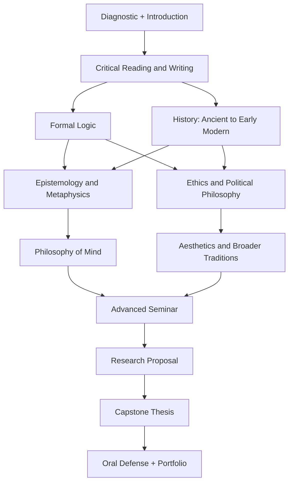

# A University-Level Philosophy Education with OpenAI Dots as Tutor

## Executive summary

A rigorous self-directed philosophy education should be designed less like a sequence of books to “get through” and more like a university major: **breadth requirements, cumulative skill development, repeated writing and oral defense, formal logic, historical study, advanced seminars, and a substantial capstone**. That pattern is visible across leading undergraduate programs. Princeton distributes work across metaphysics, value theory, logic/philosophy of science, and history; Harvard requires coverage of logic, contemporary metaphysics/epistemology, value theory, and history plus tutorials; Brown requires ancient philosophy, early modern philosophy, logic, metaphysics/epistemology, ethics/political philosophy, a seminar, and a capstone; MIT requires introductory work, history, knowledge/reality, value theory, logic, an advanced topics course, and electives; UC San Diego has an unusually explicit fifteen-course structure including two levels of logic, a three-course history sequence, value theory, metaphysics/epistemology, philosophy of science, and electives. citeturn7view0turn7view1turn13view0turn18view0turn19view0

The plan below therefore treats philosophy as four intertwined competencies rather than simply content knowledge: **close reading of difficult primary texts; reconstruction and evaluation of arguments; clear philosophical writing and oral argument; and increasing independence in research**. Brown explicitly lists analytical thinking, familiarity with major historical figures, logical proof, and significant written philosophical work among its undergraduate goals, while MIT describes its major in terms of familiarity with central problems, technical skills, independent philosophical study, and advanced work. citeturn13view0turn18view0

Pedagogically, the strongest design is a **mixed model**. Short lectures or explanatory briefings efficiently establish historical and conceptual context; Socratic tutorials force the student to articulate reasons rather than recognize answers; seminars develop objection-and-reply skills; and active exercises—argument maps, logic problems, thought experiments, case analyses, précis writing, oral defenses, and retrieval quizzes—turn passive familiarity into usable intellectual skill. A large meta-analysis of critical-thinking instruction found positive effects across 117 studies and more than 20,000 participants, while research on learning supports distributed practice and retrieval practice rather than repeated passive rereading. Argument mapping has also been specifically advocated in critical-thinking pedagogy. citeturn22search3turn21search2turn23search0turn22search22

The recommended default is a **four-year, approximately ten-hour-per-week “philosophy-major-equivalent” track**. This is deliberately comparable in philosophy-specific intellectual scope to the smaller U.S. majors—Princeton, for example, requires eight departmental courses—rather than to an entire bachelor's degree with general education, language study, electives, campus seminars, and accredited assessment. citeturn7view0 A three-year version works at roughly 12–15 hours per week; a one-year intensive version requires approximately 30 hours per week and should be understood as an immersion program rather than a plausible substitute for the social and developmental experience of four years at a university.

OpenAI's Dots are particularly well suited to the **director-of-studies** role because OpenAI describes a dot as an always-on ChatGPT agent capable of maintaining context between conversations, taking ongoing responsibility, using connected information, remembering relevant context, scheduling work, and providing proactive updates. OpenAI also explicitly warns that dots can make mistakes and recommends reviewing important work. citeturn2view0 That makes the optimal division of labor: **Dot manages the curriculum, schedule, mastery record, reading queue, quizzes, feedback cycles, oral examinations, and accountability; the student does the reading and produces first-pass reasoning independently; primary texts, SEP, and scholarly literature arbitrate factual or interpretive disputes.**

For especially interactive sessions, OpenAI's separate ChatGPT Study mode is a useful model: its documented behavior includes Socratic questioning, step-by-step explanation, comprehension checks, use of uploaded syllabi/materials, and personalization from memory. OpenAI's documentation does not establish that Study mode itself runs *inside* a Dot, so this report does not assume that integration; instead, the Dot can be instructed to follow the same tutoring pattern, while ordinary Study mode can be used separately when useful. citeturn2view1

**Recommended progression**

```text
YEAR 1                     YEAR 2                        YEAR 3                       YEAR 4
Foundations ───────────► History + Value ───────────► Core Theory ─────────────► Research
Intro & reading            Ancient/early modern         Epistemology                 Advanced seminar
Argument analysis          Ethics                       Metaphysics                   Specialized elective
Formal logic               Political philosophy        Philosophy of mind           Thesis
Short essays               Historical comparison       Aesthetics                   Oral defense
```

At successful completion, the student should be able to read a difficult philosophical passage without immediately outsourcing its interpretation; represent arguments in premise-conclusion form; distinguish validity from soundness and necessary from sufficient conditions; handle basic propositional and predicate logic; explain central disputes in ethics, epistemology, metaphysics, philosophy of mind, political philosophy, and aesthetics; situate major historical figures; research contemporary literature through SEP and PhilPapers; write sustained analytical papers; present and defend a position orally; and complete an independent capstone comparable in intellectual ambition, though not institutional status, to an undergraduate senior project. Brown's capstone options range from substantial papers or projects to a 40–60-page thesis, while Harvard's honors route includes a thesis of up to 20,000 words and an oral examination. citeturn13view1turn7view1

## What leading programs and the evidence imply

The most useful lesson from university curricula is **not** to copy one institution literally. Harvard deliberately describes its philosophy curriculum as comparatively nonlinear and notes that most concentrators arrive without prior philosophy; UC San Diego, by contrast, imposes a tightly ordered history sequence and two stages of logic. Princeton emphasizes distribution across philosophical areas, while Brown combines area requirements with a seminar and capstone. citeturn7view1turn19view0turn7view0turn13view0turn13view1 A self-study curriculum can take the best feature of each: Harvard's accessibility, Princeton's breadth, Brown's capstone, MIT's explicit combination of history/value/knowledge/logic, and UCSD's cumulative sequencing.

| Leading program | Scale and structure | Breadth/core requirements | Advanced work | Best feature to borrow |
|---|---|---|---|---|
| **Princeton** | Eight departmental courses for the major | Normally six courses distributed as two courses in three of four areas: metaphysics, ethics/value, logic/philosophy of science, and history | Upper-level work and independent work are integrated into the broader program | A simple **distribution requirement** preventing over-specialization. citeturn7view0 |
| **Harvard** | Eleven philosophy courses in the basic concentration | At least one course in each of logic; contemporary metaphysics/epistemology; moral/political/aesthetic philosophy; and history, plus tutorials and electives | Honors route includes senior tutorial, thesis, and oral examination | **Tutorials + broad areas + thesis/oral defense**; also explicitly friendly to students with no prior philosophy. citeturn7view1 |
| **Brown** | Ten philosophy courses | Ancient Greek philosophy, early modern philosophy, logic, epistemology/metaphysics, ethics/political philosophy | At least one seminar and a senior capstone; thesis option is approximately 40–60 pages | An unusually clear **skills-to-capstone progression**. citeturn13view0turn13view1 |
| **MIT** | Roughly eleven subjects in its traditional philosophy-major structure, including a coherent elective program | Introduction, history, knowledge/reality, value, logic, advanced Topics in Philosophy, plus restricted electives | At least two philosophy courses at the 200 level or above; advanced topics requirement | Strong **formal/core-theoretical spine**, with philosophy of mind, science, language and technical logic readily incorporated. citeturn18view0 |
| **UC San Diego** | Fifteen courses; at least twelve upper-division | Introductory logic, symbolic logic, ancient/early-modern/late-modern history sequence, moral/political philosophy, metaphysics/epistemology, philosophy of science, plus seven electives | Optional emphases in law/ethics, science/technology/medicine, mind/brain/cognitive science, and historical perspectives | Best model here for an explicit **cumulative sequence** and substantial depth. citeturn19view0 |

The common denominator is striking: a serious curriculum repeatedly returns to **history, value theory, metaphysics/epistemology, and logic**, then adds specialization. Harvard explicitly groups aesthetics with moral and political philosophy; MIT has philosophy of the arts among its value offerings; UCSD gives mind, science, language, ethics and politics prominent places in its core or elective architecture. citeturn7view1turn18view0turn19view0 This supports treating the user's requested subjects not as nine unrelated courses but as a connected conceptual system.

The recommended pedagogical mix is therefore:

| Mode | Role in philosophy | Recommended use |
|---|---|---|
| **Lecture / mini-lecture** | Supplies chronology, terminology, philosophical context, and a map of a debate before primary reading | Keep to roughly 15–25% of instructional time. Dot should usually explain *after* an initial attempt at reading, not before every text. |
| **Socratic tutorial** | Exposes unsupported assumptions and forces reasons, distinctions, counterexamples, and revisions | One 45–60 minute session per week. Dot asks one question at a time and withholds the model answer until the student has committed to a view. This mirrors the Socratic behavior OpenAI documents for Study mode. citeturn2view1 |
| **Seminar** | Develops interpretation, objection, reply, charitable disagreement, and oral presentation | One longer discussion every two weeks; Brown's explicit seminar requirement and Harvard's tutorials reinforce the importance of discussion-based advanced work. citeturn13view0turn7view1 |
| **Active learning** | Converts recognition into performance: argument maps, thought experiments, logic proofs, counterexample generation, debate, application | Use in almost every meeting. Critical-thinking meta-analysis and argument-mapping research favor explicit practice rather than assuming that critical thinking automatically emerges from exposure to content. citeturn22search3turn22search22 |
| **Retrieval and spacing** | Makes concepts, distinctions, argument structures, and logical rules durable | Brief cumulative quizzes every week; revisit earlier philosophers after 1 week, 3–4 weeks, and at the end of term. Distributed-practice and retrieval-practice research support this approach. citeturn21search2turn23search0 |
| **Draft–feedback–revision** | Teaches philosophy as a revisable craft rather than one-shot performance | Every substantial paper gets structural feedback, a revision plan, and a final submission; formative feedback should primarily help the student regulate subsequent work rather than merely justify a grade. citeturn21search19 |

A key qualification is that much of the strongest experimental literature on retrieval, spacing, and active learning is **general educational or cognitive research rather than philosophy-specific randomized evidence**. Philosophy adds discipline-specific requirements—charitable reconstruction, textual interpretation, conceptual distinction, objection/reply, and formal argument—that justify supplementing the general evidence with philosophy-focused critical-thinking work and the actual practices of philosophy departments. citeturn21search2turn23search0turn22search22

This suggests an important rule for AI tutoring: **difficulty should usually precede explanation**. Reading Plato or Kant should begin with the student's own annotation and reconstruction, even when incomplete. If Dot immediately produces a polished interpretation, the student can acquire the illusion of understanding without practicing interpretation. Retrieval research likewise distinguishes successful long-term learning from mere fluent restudy. citeturn23search0turn21search25 Dot should therefore behave more like a tutor who diagnoses and scaffolds than like an answer engine.

## Curriculum, primary texts, and scholarly resources

The curriculum should distinguish **primary texts**, where the philosophical argument actually occurs, from **secondary literature**, which supplies interpretation and scholarly context. SEP is especially appropriate for the latter role: the Stanford Encyclopedia of Philosophy describes itself as an up-to-date reference work written and maintained by philosophers and scholars around the world. citeturn25view0 PhilPapers should be the main bibliographic discovery layer: it describes itself as a comprehensive philosophy index covering journals, books, and open archives, with categories spanning metaphysics, epistemology, mind, aesthetics, ethics, political philosophy, logic, history, African/Africana philosophy, Asian philosophy, and other traditions. citeturn25view1

**Core reading canon and recommended editions**

The editions below are recommendations rather than claims that one translation is uniquely authoritative. For major essays and articles, use the original journal publication or an academically reputable anthology; for quote-sensitive assignments, keep one stable edition throughout the course.

| Area | Core primary reading | Recommended edition/source | Why it earns a place |
|---|---|---|---|
| **Introduction / Socratic method** | Plato, *Euthyphro*, *Apology*, *Crito*, *Meno*; *Republic* selections | *Plato: Complete Works*, ed. John M. Cooper, Hackett | Excellent first training in definition, counterexample, dialectic, justice, knowledge and argument. |
| **Ancient philosophy** | Aristotle, *Nicomachean Ethics*; selections from *Metaphysics* and *De Anima* | *Nicomachean Ethics*, trans. Terence Irwin, Hackett; scholarly translation for other works | Introduces virtue, flourishing, practical reasoning, substance, causation, soul and mind. |
| **Early modern epistemology/metaphysics** | Descartes, *Meditations on First Philosophy*; correspondence with Princess Elisabeth | Donald Cress's Hackett translation for the *Meditations*; Lisa Shapiro's edition of the correspondence is useful for mind/body criticism | Provides a central route into skepticism, foundations, dualism, representation and mind-body problems. |
| **Empiricism** | Hume, *An Enquiry Concerning Human Understanding*; causation and induction | Tom L. Beauchamp's Oxford edition is particularly useful for scholarly study | Core treatment of causation, induction, skepticism and empiricist method. |
| **Kant** | *Groundwork of the Metaphysics of Morals*; later, selected *Critique of Pure Reason* and *Critique of Judgment* | Gregor/Timmermann Cambridge edition for the *Groundwork* | Makes autonomy, duty, universality and the limits of reason unavoidable parts of the curriculum. |
| **Modern ethics/liberty** | Mill, *Utilitarianism* and *On Liberty* | A scholarly Oxford World's Classics or Hackett edition | Consequentialism, freedom, harm, individuality and liberal political theory. |
| **Gender and political modernity** | Wollstonecraft, *A Vindication of the Rights of Woman*; selected texts by Du Bois and de Beauvoir | Scholarly Oxford/Penguin editions; de Beauvoir's *Ethics of Ambiguity* is a manageable complete work | Corrects the distortion created by treating the canonical European male tradition as the whole history of philosophy. |
| **Analytic epistemology** | Gettier, “Is Justified True Belief Knowledge?”; Goldman selections; Fricker, *Epistemic Injustice* | Original articles; Fricker, Oxford University Press | Moves from the analysis of knowledge to reliability, testimony, social epistemology and epistemic power. |
| **Metaphysics** | Leibniz selections; identity/persistence readings; Parfit, *Reasons and Persons*, personal-identity sections | Scholarly editions and original publications | Trains modal, identity, persistence and reductionist reasoning. |
| **Philosophy of mind** | Smart or Place on mind-brain identity; Putnam on functionalism; Nagel, “What Is It Like to Be a Bat?”; Jackson, “Epiphenomenal Qualia”; Chalmers on consciousness | Original journal articles/authoritative reprints | Produces a historically coherent route through physicalism, functionalism, qualia and consciousness. |
| **Political philosophy** | Hobbes, *Leviathan* selections; Locke, *Second Treatise*; Rousseau, *Social Contract*; Rawls, *A Theory of Justice*; Nozick, *Anarchy, State, and Utopia* selections | Rawls revised edition, Harvard University Press; scholarly editions for early modern works | Gives the student competing accounts of authority, rights, consent, liberty, equality and distributive justice. |
| **Aesthetics** | Hume, “Of the Standard of Taste”; Kant, *Critique of Judgment* selections; Danto, “The Artworld”; Walton or similar contemporary work | Original essays plus a scholarly Kant edition | Covers judgment, taste, interpretation, art-status and aesthetic properties. |
| **Logic** | Propositional logic, predicate logic, validity, natural deduction; later modal logic basics | *forall x: Calgary* | This is a free, full-featured formal-logic text covering consequence, validity, truth-functional and first-order logic, symbolization and Fitch-style natural deduction, with exercises and solutions. citeturn25view2 |

The canon should be treated as a **spine, not a boundary**. PhilPapers' taxonomy itself reflects a field that now includes African/Africana philosophy, Asian philosophy, philosophy of gender/race/sexuality, philosophy of computing, social epistemology, philosophy of cognitive science and numerous other subfields. citeturn25view1 A genuinely university-level program should therefore reserve electives for at least one non-European tradition and one contemporary area such as philosophy of race, feminist philosophy, philosophy of AI/technology, philosophy of science, environmental philosophy or philosophy of law.

For secondary literature, the strongest hierarchy is **SEP entry first, focused monograph or Cambridge/Oxford companion chapter second, journal literature third**. SEP is best used before and after a unit: briefly before reading to establish the map of positions, then more carefully after the primary text to test whether the student's reconstruction omitted major issues. citeturn25view0 PhilPapers is better for the research-paper stage, because its purpose is bibliographic coverage rather than encyclopedia-style exposition, and it includes a large open-access archive through PhilArchive. citeturn25view1

A useful secondary shelf would include Simon Blackburn's *Think* or Thomas Nagel's *What Does It All Mean?* for first orientation; Anthony Kenny's *A New History of Western Philosophy* and Peter Adamson's *A History of Philosophy Without Any Gaps* for historical scaffolding; a contemporary ethics introduction such as Russ Shafer-Landau; Duncan Pritchard for epistemology; John Heil for philosophy of mind; Jonathan Wolff for political philosophy; and a modern aesthetics introduction such as Gordon Graham. These should remain **companions rather than substitutes for primary works**.

For open-access study, use the following division of labor:

| Resource | Best use |
|---|---|
| **Stanford Encyclopedia of Philosophy** | Authoritative orientation, debate maps, concepts and bibliographies; it is maintained as an up-to-date scholarly reference work. citeturn25view0 |
| **PhilPapers / PhilArchive** | Literature searches, bibliographies, discovering contemporary journal debates and open-access versions. citeturn25view1 |
| **MIT OpenCourseWare** | Models for course architecture and freely available university course materials; MIT's philosophy department links students directly to OCW among its course resources. citeturn18view0 |
| **Open Yale Courses** | Full introductory university-course materials; Yale describes OYC as free and open access to selected introductory courses taught by Yale faculty. citeturn24search2 |
| **forall x: Calgary / Open Logic Project** | Primary textbook for formal logic; includes TFL, FOL, natural deduction, exercises and solutions and is openly licensed. citeturn25view2 |
| **Early Modern Texts** | Accessibility aid for difficult early-modern prose. Its texts deliberately modernize presentation to make classics easier to read while preserving the central arguments and doctrines; therefore use it as a bridge, not as the edition from which to make historically sensitive wording claims. citeturn25view3 |
| **Official university department pages** | Periodically recalibrate your plan against real major requirements, advanced seminars and current course offerings rather than trusting generic “best philosophy books” lists. Harvard, Princeton, Brown, MIT and UCSD illustrate substantially different but overlapping curricular models. citeturn7view0turn7view1turn13view0turn18view0turn19view0 |

The reading method matters as much as the bibliography. For every serious primary text, use a **four-pass protocol**: first read without secondary commentary and mark the question/problem; second reconstruct the argument in numbered premises and conclusion; third read SEP or another scholarly secondary source; fourth return to the text and write an objection and the strongest reply available to the author. This deliberately combines direct engagement, explicit critical-thinking practice, retrieval and revision rather than passive rereading. citeturn22search3turn23search0turn21search25

A reasonable ten-hour week should generally target **roughly four hours of difficult reading rather than a rigid page count**. Forty pages of Kant can require more intellectual labor than 100 pages of accessible secondary prose. A practical target is approximately 50–100 pages of combined primary and secondary material in an ordinary week, dropping substantially for exceptionally dense works. The important constraint is that reading must leave enough time for reconstruction and writing; a curriculum that maximizes pages at the expense of producing arguments is poorly designed.

## Four-year university-level track

The four-year track is the recommended option for a student beginning with no prior coursework. It deliberately starts more slowly than many reading lists because Harvard notes that most of its concentrators enter without previous philosophy and designs introductory courses to teach philosophical reading and writing as well as content. citeturn7view1 The aim is cumulative independence: Dot should provide a great deal of scaffolding during the first semester and progressively less by the fourth year.

| Semester | Core study | Representative primary material | Major assessed output | End-of-semester milestone |
|---|---|---|---|---|
| **Year One — Fall** | Introduction to philosophy; critical reading; arguments; philosophical writing | Plato's *Euthyphro*, *Apology*, *Meno*; Descartes *Meditations* I–II; Gettier; one ethics paper | Three 1,000–1,500-word analytic essays; argument maps; short oral exam | Identify premises/conclusions; distinguish validity, soundness, objections and counterexamples; write a defensible thesis. |
| **Year One — Spring** | Formal logic and critical reasoning | *forall x: Calgary* through propositional and first-order logic; short philosophical arguments used as formalization exercises | Weekly problem sets, two timed tests, one “logic of a philosophical argument” paper | Competence in symbolization, truth tables/semantics, validity and introductory natural deduction. The open text explicitly covers these domains. citeturn25view2 |
| **Year Two — Fall** | History of philosophy: ancient to early modern | Plato; Aristotle; selected medieval material; Descartes; Elisabeth; Locke/Leibniz selections; Hume | 2,000–2,500-word comparative historical essay plus oral commentary | Explain a philosopher in the philosopher's own conceptual framework before criticizing the view. UCSD's required ancient→early modern→late modern sequence is a useful model for cumulative historical study. citeturn19view0 |
| **Year Two — Spring** | Ethics and political philosophy | Aristotle, Kant, Mill, Wollstonecraft, Hobbes/Locke/Rousseau selections, Rawls, Nozick, contemporary critics | Applied-ethics argument; 2,500-word normative theory paper; 12-minute presentation | Distinguish consequentialist, deontological, contractualist, virtue-oriented and rights-based reasoning; defend a political principle against objections. |
| **Year Three — Fall** | Epistemology and metaphysics | Descartes/Hume revisited; Gettier; contemporary epistemology; causation, modality, identity, persistence/free will selections | Two 2,500–3,000-word papers; annotated PhilPapers bibliography | Move from textbook-level “positions” to scholarly disputes; independently locate and evaluate secondary literature. PhilPapers is explicitly designed as a comprehensive research index. citeturn25view1 |
| **Year Three — Spring** | Philosophy of mind and aesthetics | Identity theory, functionalism, Nagel, Jackson, Chalmers; Hume/Kant/Danto/modern aesthetics | Research essay; conference-style 15-minute presentation and questions | Compare theories across multiple papers, formulate an original argumentative contribution, and defend it orally. |
| **Year Four — Fall** | Advanced seminar; nineteenth/twentieth-century or global/comparative philosophy; research methods | Nietzsche, Du Bois, de Beauvoir or another thematic sequence, plus specialized contemporary articles | 3,500–5,000-word seminar paper; capstone proposal; literature review | Conduct an independent scholarly search, define a manageable research question and distinguish expository background from original argument. |
| **Year Four — Spring** | Capstone thesis and oral defense | Student-selected primary and peer-reviewed research literature | 8,000–12,000-word thesis; 20–30 minute presentation; 30–45 minute oral defense | Produce, revise and defend a sustained philosophical argument. Brown and Harvard both use substantial capstone/thesis work, with Harvard's honors option also requiring oral examination. citeturn13view1turn7view1 |

The sequence can be visualized as a dependency graph:



This dependency structure synthesizes the ordered approach seen especially clearly at UCSD with the broad-area distribution used at Princeton and Harvard. citeturn19view0turn7view0turn7view1 Logic occurs early because it provides a reusable vocabulary for later argument analysis, while history precedes most advanced thematic work so that contemporary debates are not encountered without intellectual context.

**Standard fifteen-week semester rhythm**

| Week | Activity | Evidence of progress |
|---|---|---|
| **Opening week** | Diagnostic essay, argument-reconstruction test, baseline oral questioning | No grade; establish mastery profile |
| **Weeks 2–4** | Primary reading, mini-lectures, argument maps, Socratic tutorials | Weekly 300–500-word précis + cumulative retrieval quiz |
| **Week 5** | First analytic essay | Marked against common rubric |
| **Weeks 6–7** | New material plus explicit correction of weaknesses revealed by Essay One | Revised paragraph/argument map |
| **Week 8** | Midterm: short answers, argument analysis and/or logic problems | Closed-AI assessment |
| **Weeks 9–11** | Advanced readings and seminar-style discussion | Student-led presentation/discussion |
| **Week 12** | Research question and annotated bibliography | Five to eight genuinely relevant scholarly items |
| **Week 13** | Major-paper draft | Structural feedback only at first pass |
| **Week 14** | Oral examination or defense of draft | Unscripted follow-up questions |
| **Week 15** | Revised final paper + cumulative retrieval exercise + reflection | Portfolio update and next-semester skill goals |

The repeated quizzes are intentionally cumulative. Retrieval testing has demonstrated long-term retention benefits, while distributed-practice research supports revisiting material over time rather than concentrating all review immediately before an examination. citeturn23search0turn21search2 The draft-revision cycle also ensures that assessment produces future learning rather than merely a score.

A standard **ten-hour week** should look approximately like this:

| Activity | Hours | What actually happens |
|---|---:|---|
| Primary-text reading and annotation | 3.0 | Slow reading; mark claims, transitions, technical terms, ambiguities |
| Secondary reading / contextual mini-lecture | 1.0 | SEP, scholarly chapter, occasional university lecture |
| Argument reconstruction / logic | 1.5 | Premise-conclusion maps, formalization, counterexample generation |
| Dot Socratic tutorial | 1.0 | Student explains; Dot questions |
| Writing / revision | 2.0 | Précis, essay paragraphs, objection/reply |
| Retrieval / oral practice | 0.75 | Cumulative quiz or rapid oral questions |
| Weekly planning and learning log | 0.75 | Mastery dashboard and next-week adjustments |
| **Total** | **10.0** | |

The goal is not equal excellence in all areas immediately. Progress should look developmental:

**End of Year One:** accurately reconstruct relatively short arguments; explain validity versus soundness; detect ambiguity; produce a focused 1,500-word argument; complete elementary formal-logic exercises.

**End of Year Two:** read major historical primary texts with less explanatory dependence; compare philosophers without anachronism; handle ethical and political objections; write 2,000–2,500-word papers that distinguish exposition from criticism.

**End of Year Three:** perform independent scholarly literature searches through SEP bibliographies and PhilPapers; synthesize multiple contemporary papers; develop objections that are not mere assertions; sustain a 3,000-word research argument. SEP and PhilPapers are complementary here: the former provides maintained scholarly reference entries, while the latter is an extensive philosophy research index and bibliography. citeturn25view0turn25view1

**End of Year Four:** define a research question narrow enough to answer, produce an 8,000–12,000-word capstone with a recognizable original argumentative contribution, revise it after criticism, and defend it orally without reading a prepared script. That scale sits below Harvard's possible 20,000-word honors thesis and around the territory implied by Brown's 40–60-page thesis option, making it ambitious but realistic for independent study. citeturn7view1turn13view1

## Intensive and alternative timelines

Time compression should reduce redundancy, not standards. The one-year track therefore retains logic, history, major systematic areas, repeated essays, oral examination and a capstone; what it necessarily sacrifices is slow maturation, broad electives, extensive rereading, and the repeated exposure to live peer disagreement that students obtain across several university years.

| Scenario | Weekly commitment | Calendar model | Approximate philosophy study time | Best fit |
|---|---:|---|---:|---|
| **Part-time four-year** | 10 hrs/week | ~30 instructional weeks + lighter summer review per year | Roughly 1,200+ structured hours, with optional summer work beyond that | Recommended default; highest chance of genuine retention and intellectual maturation |
| **Three-year** | 12–15 hrs/week | Two 15-week terms plus summer reading/research | Roughly similar total core hours but more compressed | Strong reader/writer with consistent schedule |
| **Full-time** | 30 hrs/week | University-like workload | Allows two or three substantive strands at once | Student treating philosophy as principal occupation |
| **One-year intensive** | ~30 hrs/week | Two 18-week semesters + 10-week capstone/research block + breaks | About 1,380 scheduled hours | Maximum practical compression while preserving substantial writing and research |
| **Accelerated sub-year sprint** | 35–40+ hrs/week | Continuous intensive study | Can cover material, but retention and reflection become bottlenecks | Better viewed as survey/preparation than equivalent intellectual formation |

The hour totals above are **planning targets for this curriculum**, not claims that an exact number of hours creates university equivalence. The reason to retain spacing even in the intensive program is that distributed practice is consistently preferable to treating learning as a single massed exposure. citeturn21search2

**Three-year compression**

The three-year model combines adjacent stages of the four-year sequence. In Year One, take Introduction/Argumentation and Logic in the first semester, then Ancient–Early Modern History in the second, with summer reading in later modern philosophy. In Year Two, take Ethics/Political Philosophy followed by Epistemology/Metaphysics, with a summer research mini-project. In Year Three, combine Mind/Aesthetics with an advanced seminar, then devote the final semester to a capstone. The student should average 12–15 hours weekly and should not compress the thesis into the last few weeks.

**One-year intensive, semester-by-semester**

| Period | Workload and curriculum | Reading pattern | Required assessments |
|---|---|---|---|
| **Intensive Semester One — 18 weeks** | ~30 hrs/week. Parallel strands: Introduction/argumentation; Formal Logic; Ancient-to-Early-Modern History | ~10–12 hrs primary reading; 4 hrs secondary/context; 5 hrs logic/problem solving; 4 hrs tutorial/seminar; 4–5 hrs writing/revision | Weekly logic sets and retrieval quizzes; three analytic essays; historical comparative paper; midterm; oral examination |
| **Intensive Semester Two — 18 weeks** | ~30 hrs/week. Ethics/Political Philosophy; Epistemology/Metaphysics; Mind/Aesthetics in rotating six-week concentrations | 10–12 hrs primary/current articles; 4–5 hrs SEP/secondary literature; 3 hrs argument mapping; 3 hrs seminar; 6–8 hrs writing/research | Ethical case paper; epistemology/metaphysics paper; mind/aesthetics presentation; cumulative written exam; research proposal |
| **Capstone Block — 10 weeks** | ~30 hrs/week. Specialized reading + independent thesis | 8–10 hrs literature research; 15+ hrs planning/drafting/revision; 3–5 hrs oral defense and consultation preparation | Annotated bibliography; 2,000-word prospectus; complete draft; 8,000–12,000-word thesis; oral defense |

The one-year program should use **interleaving without constant topic-switching**. Semester Two, for example, should not require serious Kant, Rawls, Gettier, Lewis, Nagel and Danto every day. Six-week concentrations permit deeper immersion while cumulative quizzes preserve earlier material. The rationale combines the need for active critical-thinking instruction with spacing and retrieval. citeturn22search3turn21search2turn23search0

A suggested intensive week is 11 hours primary/secondary reading, four hours formal reconstruction or logic, four hours live work with Dot, seven hours writing/problem sets, two hours retrieval testing, and two hours research planning/reflection. At thirty hours per week, the chief danger is not insufficient exposure but **outsourcing the hard cognitive work to AI**. Therefore, every graded paper, précis, argument map, and oral response should begin without Dot-generated content.

No compressed plan should be represented as an accredited degree. It can plausibly recreate a strong philosophy major's **content, exercises and assessment standards**, but it cannot reproduce institutional accreditation, faculty judgment, a real student seminar community, library privileges, campus intellectual life or the broader non-philosophy coursework of a bachelor's degree.

## Using Dots as professor, tutor, and director of studies

OpenAI's current documentation makes Dot a particularly natural **persistent director of studies**: it can hold ongoing responsibility, preserve relevant context, create scheduled work, provide proactive updates and use connected applications. Its profile distinguishes in-progress, scheduled and completed work. citeturn2view0 Those capabilities should be used for longitudinal administration rather than to make the agent write more of the student's philosophy.

The best architecture is:

**Student:** reads, reconstructs, argues, drafts, takes closed-AI tests and makes interpretive commitments.

**Dot:** plans, questions, diagnoses, assigns exercises, tracks performance, supplies carefully limited hints, grades against published rubrics, schedules retrieval, maintains the bibliography and forces revision.

**Primary texts and scholarly sources:** settle quotation, attribution and interpretation questions.

**SEP:** establishes the scholarly map and terminology. citeturn25view0

**PhilPapers:** discovers the research literature and open-access scholarship. citeturn25view1

OpenAI explicitly cautions that a dot can make mistakes and that important details should be checked. citeturn2view0 Accordingly, Dot should never be allowed to grade textual accuracy solely from its memory. For any disputed attribution—“Kant says X,” “Hume denies Y,” “Rawls's difference principle means Z”—it should either check the assigned text or clearly label its statement as an interpretation requiring verification.

A strong initial instruction for the Dot is:

> **Professor contract**
>
> You are my philosophy professor, tutor, examiner, and director of studies for a university-level self-study program. Assume no prior philosophy coursework.
>
> Your objective is not to maximize how much information you tell me. Your objective is to make me independently competent at philosophical reading, argument reconstruction, formal reasoning, writing, research, discussion, and oral defense.
>
> Default to Socratic teaching. Ask one substantive question at a time. Before explaining a passage or solving an argument problem, require my attempt unless I explicitly request direct exposition. When I make a claim, ask for my reason; when I give a reason, test it with a counterexample or objection; when I revise, ask what changed.
>
> Maintain a curriculum and mastery record covering introduction, history of philosophy, ethics, political philosophy, epistemology, metaphysics, formal logic, philosophy of mind, and aesthetics. Add advanced electives only after the foundation is secure.
>
> For reading assignments, prioritize primary texts. Use the Stanford Encyclopedia of Philosophy for scholarly orientation, PhilPapers for literature searches, original peer-reviewed papers for contemporary debates, and official university material for curriculum models.
>
> Never invent a quotation, page number, bibliographic citation, philosopher's position, or source. Distinguish quotation, paraphrase, reconstruction, and your own interpretation.
>
> Never rewrite my philosophy essay into a polished submission before I have revised it myself. First diagnose problems by category: thesis, reconstruction, reasoning, objections/replies, textual evidence, organization, and prose. Give questions or localized feedback before offering model prose.
>
> Run cumulative retrieval every week. Revisit material after approximately one week, one month, and at the end of the semester.
>
> Give me periodic closed-AI assessments that I complete independently and submit afterward for grading. Conduct oral exams with unpredictable follow-up questions.
>
> Grade all major work using the common rubric in this program. Keep both numerical scores and a 0–4 mastery profile. Do not inflate grades to encourage me.
>
> At the end of every week provide: work completed, evidence of mastery, unresolved weaknesses, overdue work, and next week's plan.

The structure parallels documented Study-mode behaviors—Socratic questions, staged explanation and comprehension checks—without assuming Study mode is technically embedded in Dot. citeturn2view1

**Socratic tutorial template**

> “Today we are discussing Hume on induction. Do not lecture unless I become stuck. Begin by asking me to state the problem of induction in my own words. Then make me identify the premises of the argument. Ask only one question at a time. After my reconstruction, attack the weakest premise. Ask me to defend Hume. Then switch roles and make me formulate the strongest objection. Do not reveal your preferred reconstruction until the final ten minutes.”

**Close-reading template**

> “I will paste a passage from Kant. First ask me for a one-sentence paraphrase. Then ask what problem the paragraph is answering, identify each inferential transition with me, and ask me to distinguish any technical terms. Do not tell me ‘what Kant means’ until I have produced a complete reconstruction. At the end, compare my reconstruction against a reliable scholarly interpretation and list only material disagreements.”

**Argument-mapping template**

> “Turn my reconstruction into an argument map only after I supply it. Label explicit premises, implicit premises, intermediate conclusions, final conclusion, objections and replies. Do not strengthen a premise silently: put any charitable repair in brackets and make me approve it.”

This approach is consistent with the broader evidence that critical thinking improves through direct practice and that argument mapping is a useful explicit reasoning tool rather than relying on exposure alone. citeturn22search3turn22search22

**Essay-feedback template**

> “Grade this draft without rewriting it. First give me the thesis you think I am defending. Then reconstruct my main argument. Identify the single largest logical problem, the strongest objection I failed to answer, any textual misrepresentation, and one organizational problem. Score the published rubric. Give me a revision memo containing questions and tasks, not replacement paragraphs. After I submit Revision Two, compare the two drafts and score improvement.”

**Oral-examination template**

> “Run a twenty-minute university-style oral exam on Descartes and Hume. Ask an opening question, then follow my actual answers rather than a script. Require reasons and textual support. Include at least one comparison question and one counterexample. Do not correct me during the exam. At the end give a transcript-based assessment for accuracy, reasoning, responsiveness, conceptual precision and ability to revise under pressure.”

**Logic-tutor template**

> “Give me one problem at a time. Do not supply the next proof step unless I request Hint Level One. Level One should identify the kind of move to consider; Level Two may name a relevant rule; Level Three may show one step. Record how many hints I use and lower my independence score when I rely on them.”

**Research-supervision template**

> “My proposed question is: [question]. Do not generate a paper for me. Test whether the question is precise, philosophically significant and manageable in 8,000–12,000 words. Help me develop PhilPapers search terms and SEP background topics. For every suggested scholarly source, verify that it exists. Distinguish foundational sources, major objections, recent contributions and optional background.”

PhilPapers is particularly appropriate for this because it indexes journal articles, books and open-access archives across detailed philosophical categories. citeturn25view1

A high-value **fifty-minute Dot tutorial** should have roughly five minutes of closed-notes retrieval, ten minutes in which the student summarizes the reading, twenty minutes of Socratic examination, ten minutes of objection/reply or argument mapping, and five minutes for an exit ticket. A ninety-minute seminar session can add a formal presentation, competing interpretations and a final synthesis. Retrieval should be kept low-stakes and cumulative because testing can strengthen long-term retention rather than functioning solely as evaluation. citeturn23search0

Dots' scheduling capabilities make recurring academic routines unusually practical. OpenAI documents both scheduled tasks and proactive updates. citeturn2view0 A sensible recurring schedule is: Monday morning issue the week's plan; Wednesday run a ten-minute cumulative quiz; Friday conduct the tutorial; Sunday produce a progress memo and schedule one retrieval question from material studied one month earlier.

Memory should be used for **academic state**, not indiscriminately. Record texts completed, essay scores, concepts repeatedly missed, logical rules mastered, research interests and deadlines. OpenAI notes that dots may form memories from connected applications and that merely disconnecting an app does not necessarily erase information already obtained; resetting the dot is the documented route for deleting its conversations, memories and tasks. citeturn2view0 Therefore, there is little reason to connect unrelated personal email, financial or other sensitive sources to a philosophy tutor.

The central anti-dependency rule is **attempt before assistance**. OpenAI's Study-mode documentation itself notes that ChatGPT can make mistakes and that important information should be checked. citeturn2view1 For philosophy, source verification is doubly important because a plausible paraphrase can subtly erase exactly the distinction an essay is supposed to analyze.

## Assessment, grading, and quality control

A credible program needs both **formative assessment**, which changes how the student learns, and **summative assessment**, which establishes whether the student can perform without assistance. Harvard's honors structure includes thesis and oral examination, while Brown's capstone can take the form of a substantial thesis, independent paper or special project/presentation. citeturn7view1turn13view1 The self-study curriculum should replicate that diversity rather than reducing evaluation to AI-generated multiple-choice quizzes.

Recommended assessment mix for a standard non-logic semester:

| Assessment | Weight | Purpose |
|---|---:|---|
| Weekly précis / reading notes / argument maps | 10% | Accuracy and disciplined preparation |
| Cumulative retrieval quizzes | 10% | Durable knowledge rather than cramming |
| First analytic essay | 15% | Early diagnosis |
| Midterm written examination | 15% | Independent, time-bounded performance |
| Seminar presentation or oral examination | 10% | Real-time reasoning |
| Major research/analytic paper | 30% | Sustained argument and revision |
| Final cumulative oral/portfolio reflection | 10% | Integration and metacognitive diagnosis |

Logic should instead assign approximately half the grade to problem sets/proofs and a substantial portion to proctored-by-self exams. A capstone term should weight the proposal/literature review, draft, final thesis and oral defense rather than weekly quizzes.

The common **analytic essay rubric** should remain stable across years so that higher scores reflect actual development rather than changing criteria.

| Criterion | Points | What excellent work demonstrates |
|---|---:|---|
| **Problem and thesis** | 15 | A precise, contestable answer to a clearly defined philosophical problem |
| **Argument reconstruction and charity** | 20 | Opposing/primary views represented accurately, explicitly and in their strongest reasonable form |
| **Reasoning** | 25 | Premises support conclusions; key assumptions are identified; distinctions do real argumentative work |
| **Objection and reply** | 15 | Engages a serious objection rather than an easily defeated straw man, followed by a reasoned response |
| **Textual/scholarly evidence** | 15 | Claims about philosophers are supported; secondary literature is relevant and accurately used |
| **Structure and prose** | 10 | Clear signposting, disciplined paragraphs, precise terms, economical prose |
| **Total** | **100** | |

For a beginner, a score of 70 should indicate a paper that has a recognizable philosophical argument but substantial weaknesses. Scores in the 80s should require generally accurate reconstruction and competent reasoning. A score above 90 should require genuine control: a precise thesis, charitable handling of alternatives, serious objections, strong responses and clean organization. Dot should not award a high grade merely because prose sounds sophisticated.

Alongside numeric grades, maintain a **mastery dashboard from zero to four**:

| Dimension | Zero | One | Two | Three | Four |
|---|---|---|---|---|---|
| Critical reading | No usable reconstruction | Notices claims but misses structure | Mostly accurate with help | Independently accurate | Handles ambiguity and competing interpretations |
| Argumentation | Assertions only | Reasons weakly connected | Basic argument works | Strong argument + objection/reply | Anticipates implications and revises strategically |
| Writing | Unstructured | Basic exposition | Clear but uneven | Coherent analytic writing | Economical, precise and publication-oriented in structure |
| Logic | No competence | Recognizes forms | Solves routine problems with help | Independent basic proficiency | Transfers formal tools to philosophy |
| Historical understanding | Anachronistic/inaccurate | Isolated facts | Basic context | Accurate comparative understanding | Connects historical argument to later debates without distortion |
| Research | Unverified web dependence | Finds sources but cannot assess them | Uses SEP/bibliographies | Independently uses PhilPapers and scholarly literature | Maps a debate and identifies a real research gap/question |
| Oral defense | Cannot explain own argument | Repeats prepared claims | Answers basic questions | Defends and revises under questioning | Handles novel objections with precision |

The target for graduation is an average of at least **three** across the core dimensions, with no core skill below two and reading/argumentation/writing at three or above. This is a proposed mastery standard, not an institutional grading rule.

Sample assignments should escalate in intellectual independence:

| Stage | Assignment |
|---|---|
| Early first year | “Reconstruct Socrates' argument in one dialogue in no more than seven premises. Identify one hidden premise and formulate a counterexample.” |
| Late first year | “Formalize three arguments from a philosophical text. Explain what formal validity does—and does not—establish about the philosophical conclusion.” |
| Second year | “Does Hume's critique of induction undermine everyday rational belief? Reconstruct his argument before defending your answer.” |
| Second year | “Compare Kantian and Millian analyses of a single moral case. The paper must identify a situation in which their recommendations diverge and explain why.” |
| Third year | “Does Gettier show that justified true belief is not knowledge, or only that a particular account of justification is defective? Engage at least three scholarly sources.” |
| Third year | Fifteen-minute presentation: “Is phenomenal consciousness compatible with physicalism?” followed by fifteen minutes of unscripted questions. |
| Fourth year | “Produce a 1,500–2,000-word literature review that maps a contemporary debate without defending a position.” |
| Capstone | 8,000–12,000-word independently researched thesis plus oral defense. |

The **closed-AI examination protocol** is essential. Dot should generate the prompt in advance but reveal only the examination itself at the scheduled time. The student then disconnects from AI assistance, completes the examination under a self-imposed time limit, and submits the untouched result afterward for grading. The purpose is not policing academic misconduct in a private course; it is obtaining valid evidence of what the student can do unaided.

Quality control also requires an **AI-error audit**. Once per month, select five claims Dot has made about philosophers, publications or arguments and verify them against assigned primary texts, SEP or original scholarly publications. Record the error rate. OpenAI itself warns that both dots and Study mode can make mistakes and recommends checking important details. citeturn2view0turn2view1 A tutor that is never audited can quietly become the student's unexamined authority—the opposite of philosophical education.

A second metric should be **independence**, not just grades. Record how many hints were required, whether an outline was student-generated or AI-generated, the percentage of an oral response given without prompting, and whether scholarly sources were discovered independently. By Year Four, Dot should be doing *less* cognitive scaffolding than in Year One even as assignments become harder. Successful tutoring ends not with maximal dependence on the tutor, but with the student's increasing ability to formulate and solve philosophical problems without it.

A third metric is **transfer**. Every semester should include at least one unfamiliar passage and one unfamiliar argument. Critical-thinking research emphasizes that thinking skills require explicit instruction and practice; the point is not merely to recognize the arguments rehearsed with the tutor. citeturn22search3turn22search22 A student who can explain the assigned interpretation of Descartes but cannot reconstruct a new argument has accumulated information without acquiring the central skill.

The strongest final portfolio would therefore contain an early first-year essay and its revision; representative logic work; one historical interpretation; one ethics/political paper; one epistemology/metaphysics paper; a philosophy-of-mind or aesthetics research paper; presentation slides plus oral-exam feedback; an annotated scholarly bibliography; the capstone thesis; and a final reflective essay identifying where the student's philosophical views changed and, crucially, **which arguments caused the changes**.

The research infrastructure for maintaining that level is unusually accessible. SEP provides a continuously maintained scholarly reference work; PhilPapers provides a comprehensive research index and large open archive; Open Yale offers free access to selected Yale introductory course materials; MIT's philosophy department directs students to MIT OpenCourseWare; and *forall x: Calgary* provides a free, openly licensed formal-logic curriculum with exercises and solutions. citeturn25view0turn25view1turn24search2turn18view0turn25view2 Together with primary texts and recurring comparison against actual university requirements, those resources are sufficient to make the proposed program intellectually serious rather than merely a guided reading list.

The governing principle is simple: **Dots should provide the continuity of a professor, not the intellectual labor of the student.** OpenAI's documented capabilities—persistent responsibility, memory, scheduling and proactive updates—make the system unusually capable of maintaining a multiyear curriculum, while its documented fallibility makes source checking indispensable. citeturn2view0 When the tutor is configured to ask before answering, diagnose before rewriting, retrieve before reteaching, demand textual evidence, grade consistently, and progressively withdraw scaffolding, the result can approximate the curricular depth and assessment practices of a strong undergraduate philosophy major while preserving the very capacity philosophy education is supposed to create: independent judgment.
